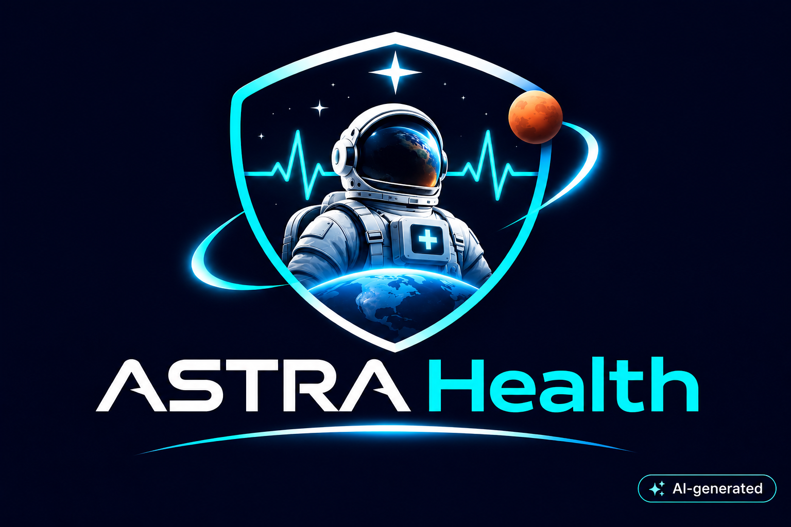
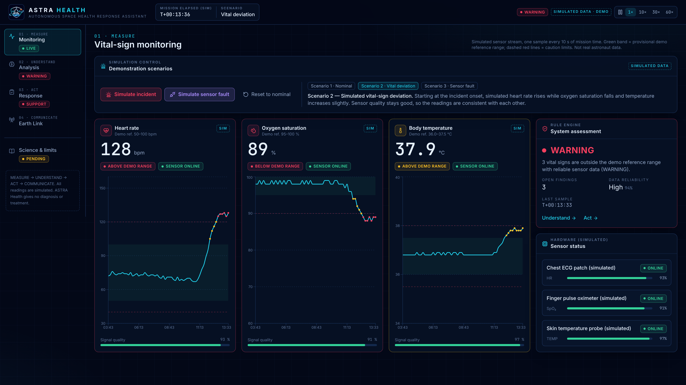
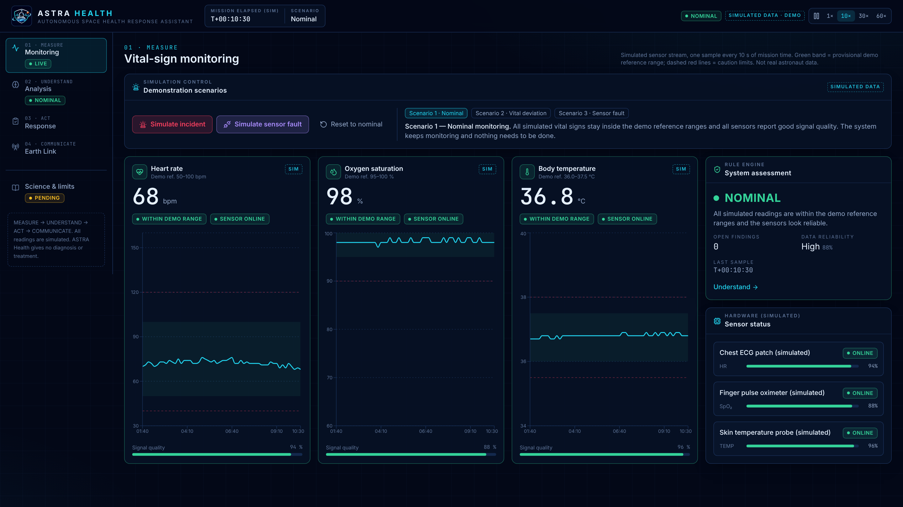
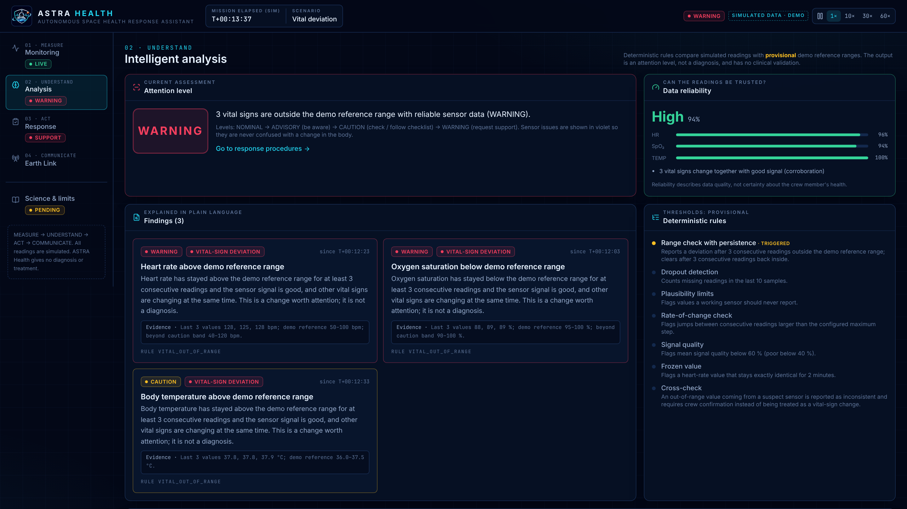
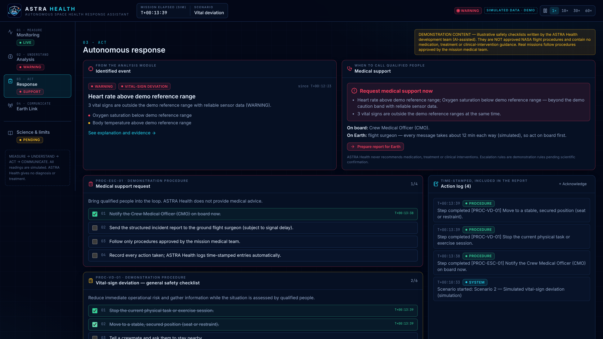
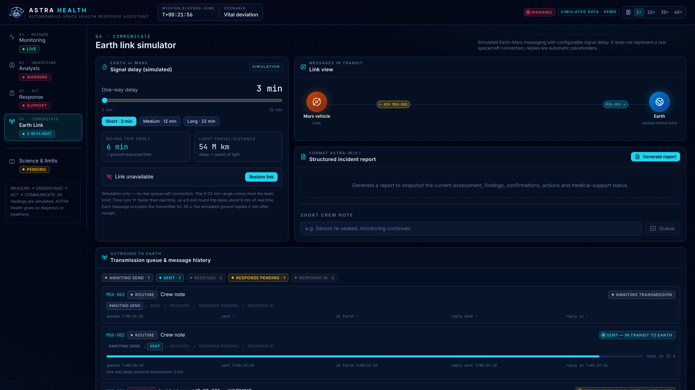
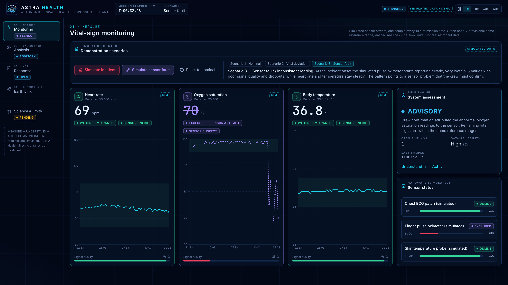

<p align="center">
  
</p>

# ASTRA Health — Autonomous Space Health Response Assistant

**Team ANGARIS · NASA Space Apps Challenge 2026**

ASTRA Health is a web MVP that helps astronauts on long-duration missions understand changes in their vital signs and
consult predefined procedures **even when communication with Earth is delayed**. It demonstrates a four-step loop:

```
MEASURE  →  UNDERSTAND  →  ACT  →  COMMUNICATE
Monitoring   Analysis       Response   Earth Link
```

> [!WARNING]
> **Demonstration prototype.** All vital-sign data is **simulated**. ASTRA Health is **not a medical device**, gives
> **no diagnosis**, recommends **no medication, treatment or clinical intervention**, and has **no clinical validation**.
> Reference ranges are **provisional placeholders** pending confirmation of the official challenge statement and NASA resource.
> See [docs/SCIENTIFIC_LIMITATIONS.md](docs/SCIENTIFIC_LIMITATIONS.md).



---

## Modules

| # | Module | What it does |
|---|--------|--------------|
| 01 | **Monitoring** (`/`) | Heart rate (bpm), SpO₂ (%), body temperature (°C); live trend charts with the demo reference band; signal quality and sensor status; buttons to simulate an incident or a sensor fault. Every value is tagged as simulated. |
| 02 | **Analysis** (`/analysis`) | Deterministic rules detect deviations and possible sensor faults, explain them in plain language with evidence, show an attention level (NOMINAL / ADVISORY / CAUTION / WARNING) and a data-reliability score, and keep an event history. |
| 03 | **Response** (`/response`) | Shows the identified event, asks the crew to confirm inconsistent measurements, presents predefined demonstration checklists, logs every action with a time stamp and indicates when medical support (Crew Medical Officer / ground flight surgeon) should be requested. |
| 04 | **Earth Link** (`/comms`) | Simulates Earth–Mars messaging with a configurable 3–22 min one-way delay, round-trip estimate, structured incident report (text + JSON), transmission queue, link outage, message states (*awaiting send → sent → received → response pending → response received*) and history. |
| — | **Science & limits** (`/science`) | NASA resource registry (pending confirmation), provisional thresholds, scientific limitations, simulated-data provenance and AI-assistance disclosure. |

## Demonstration scenarios

| Scenario | What happens | Expected flow |
|----------|--------------|---------------|
| **1 — Nominal monitoring** | All values inside the demo ranges, good signal. Loops continuously. | NOMINAL · no findings · routine-monitoring checklist · no medical support · routine status report possible. |
| **2 — Vital-sign deviation** | HR rises (~72 → ~130 bpm), SpO₂ falls (~98 → ~88 %), temperature rises (~36.7 → ~37.8 °C) with good signal quality. | Detections → escalation to WARNING · reliability High (corroborated) · *Request medical support now* · escalation + safety checklists · urgent report queued to Earth. |
| **3 — Sensor fault** | Pulse oximeter reports erratic very low SpO₂ with poor quality and dropouts while HR and temperature stay steady. | Sensor-issue findings, *reading inconsistent — confirmation needed* · reliability Low · crew takes a confirmation reading (98 %) → classified as sensor artifact, SpO₂ excluded · level drops to ADVISORY · no medical support · informational report. If the crew cannot re-measure, medical support is recommended. |

Step-by-step presenter script: [docs/DEMO_SCRIPT.md](docs/DEMO_SCRIPT.md).

## Tech stack

Next.js 16 (App Router, TypeScript) · Tailwind CSS 4 · Recharts 3 · Lucide icons · Vitest + Testing Library · Vercel.
No authentication, no database, no external APIs. Simulated data lives in JSON (`src/data/scenarios/*.json`).

## Getting started

Requirements: **Node.js ≥ 20.9** and npm.

```bash
npm install
npm run dev          # http://localhost:3000
```

Other scripts:

| Command | Purpose |
|---------|---------|
| `npm test` | Run all automated tests (unit, end-to-end scenario flows, UI). |
| `npm run lint` | ESLint (Next.js core-web-vitals + TypeScript rules). |
| `npm run typecheck` | TypeScript strict type check. |
| `npm run build && npm run start` | Production build and server. |
| `npm run generate:data` | Regenerate the simulated scenario JSON (seeded, reproducible). |
| `npm run screenshots` | Capture 16:9 presentation screenshots into `docs/screenshots/` (needs a running server and Playwright; see the script header). |

### Using the app

1. The header shows simulated mission elapsed time, the active scenario, the overall attention level and the simulation
   speed (pause, 1×, 10× default, 30×, 60×).
2. On **Monitoring**, press **Simulate incident** (scenario 2) or **Simulate sensor fault** (scenario 3); **Reset to nominal**
   returns to scenario 1. At 10× the first detections appear after ~2 s (sensor fault) or ~9 s (vital deviation), WARNING after ~15 s.
3. Follow the sidebar: **Analysis → Response → Earth Link**. State is shared across pages.

## Deploying to Vercel

The app is fully static-renderable and needs no environment variables.

1. Push the repository to GitHub.
2. In Vercel: **Add New… → Project → Import** the repository. Framework preset **Next.js** is detected automatically
   (build `next build`, output managed by Vercel, Node 20+).
3. Deploy. Or from the CLI: `npx vercel` (preview) / `npx vercel --prod`.

## Architecture

```
src/
  app/                    Routes: / (monitoring), /analysis, /response, /comms, /science
  components/             UI per module + shared primitives (layout, ui, monitor, analysis, response, comms, science)
  state/MissionProvider   React context + simulation clock (ticks every 250 ms)
  lib/
    mission/reducer.ts    Pure state machine: clock → playback → analysis → events → queue
    analysis/             Rule engine, event diffing, crew-confirmation layer
    response/             Medical-support escalation + procedure selection
    comms/                Delay maths + transmission queue/state machine
    report/               Structured incident report (ASTRA-IR/0.1)
  config/
    reference-ranges.ts   PROVISIONAL thresholds (single place to update)
    scientific-sources.ts NASA resource registry (pending confirmation)
  data/                   Simulated scenarios (JSON) + demonstration procedures (JSON)
scripts/                  Seeded data generator, screenshot capture
tests/                    Vitest: engine, comms, scenario flows, science guards, UI
docs/                     Architecture, limitations, NASA resource guide, demo script, screenshots
```

Every module is a pure, typed function of the simulated state, so the full MEASURE → UNDERSTAND → ACT → COMMUNICATE
flow is tested without a browser. Details: [docs/ARCHITECTURE.md](docs/ARCHITECTURE.md).

## Testing

`npm test` runs 52 tests in 5 files:

- `tests/scenarios.test.ts` — end-to-end flow of each of the three scenarios through the mission reducer
  (detection, escalation, procedures, confirmation, report, queue states).
- `tests/analysis.test.ts` — each rule (persistence/hysteresis, dropout, plausibility, rate of change, quality, frozen
  value, cross-check), reliability, events, confirmation outcomes, absence of diagnostic wording.
- `tests/comms.test.ts` — delay clamping, round trip, light-travel distance, FIFO/priority queue, outage, state timeline.
- `tests/science.test.ts` — guards: no NASA resource claimed while pending; provisional labels; procedures contain no
  medication/clinical-intervention terms.
- `tests/ui/modules.test.tsx` — the four modules rendered with Testing Library (incident buttons, findings, confirmation,
  checklist logging, delay presets, report generation and queuing).

## Scientific status and NASA resource

- **NASA resource:** *pending team confirmation.* The registry in `src/config/scientific-sources.ts` is intentionally
  empty; no NASA data, source or result is claimed. How to register it: [docs/NASA_RESOURCE.md](docs/NASA_RESOURCE.md).
- **Thresholds:** provisional demonstration values in `src/config/reference-ranges.ts`.
- **Earth–Mars delay:** 3–22 min one-way, taken from the team brief; to be cross-checked against the confirmed resource.

## AI assistance

Code, simulated-data generator, demonstration procedures, UI copy and documentation were produced with the help of an AI
coding assistant (Claude Code, by Anthropic) from the Team ANGARIS brief, and must be reviewed by the team. The logo is an
AI-generated image supplied by the team (labelled as such). No AI model runs inside the application. See
[AI_DISCLOSURE.md](AI_DISCLOSURE.md).

## Screenshots (16:9)

| | |
|---|---|
|  Nominal monitoring |  Analysis — vital deviation |
|  Response — medical support |  Earth link — queue states |
|  Confirmation request |  Sensor artifact excluded |

All 12 captures (2880 × 1620 px, 1920 × 1080 layout at 1.5×) are in [`docs/screenshots/`](docs/screenshots/).
