<p align="center">
  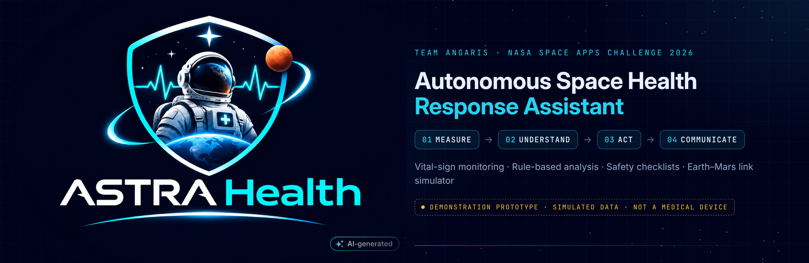
</p>

<p align="center">
  <strong>English</strong> · <a href="README.pt-BR.md">Português (Brasil)</a>
</p>

<p align="center">
  
  
  
  
  
  
  
  <a href="LICENSE"></a>
  <br/>
  
  
  
  <a href="docs/TEST_REPORT.md"></a>
</p>

<p align="center">
  <b>ASTRA Health</b> helps astronauts on long-duration missions <b>understand changes in their vital signs</b> and
  <b>follow predefined procedures</b> on board — even when every message to Earth takes minutes to arrive.
</p>

<p align="center">
  📄 <a href="docs/ASTRA_Health_ANGARIS_Technical_Documentation_EN.pdf"><b>Technical documentation (PDF)</b></a> — version 1.0, 15 November 2026
</p>

> [!WARNING]
> **Demonstration prototype.** Every vital-sign value in this project is **simulated**. ASTRA Health is **not a medical
> device**, gives **no diagnosis**, recommends **no medication, treatment or clinical intervention**, and has **no
> clinical validation**. Analysis thresholds are **provisional placeholders** until Team ANGARIS confirms the official
> challenge statement and the NASA scientific resource. See [Scientific basis & limitations](#-scientific-basis--limitations).

---

## 📑 Table of contents

1. [Overview](#-overview)
2. [The problem](#-the-problem)
3. [How it works](#-how-it-works)
4. [Modules](#-modules)
5. [Platform preview — FUTURE modules](#-platform-preview--future-modules)
6. [Demonstration scenarios](#-demonstration-scenarios)
7. [Full walkthrough — Scenario 2](#-full-walkthrough--scenario-2-vital-sign-deviation)
8. [Analysis engine](#-analysis-engine)
9. [Earth–Mars communication](#-earthmars-communication-simulator)
10. [Incident report (ASTRA-IR/0.1)](#-incident-report-astra-ir01)
11. [Architecture](#-architecture)
12. [Tech stack](#-tech-stack)
13. [Getting started](#-getting-started)
14. [Testing](#-testing)
15. [Screenshots & banners](#-screenshots--banners)
16. [Deployment (Vercel)](#-deployment-vercel)
17. [Scientific basis & limitations](#-scientific-basis--limitations)
18. [Roadmap](#-roadmap)
19. [AI Tools & Usage Disclosure](#-ai-tools--usage-disclosure)
20. [Team, license & acknowledgements](#-team)

---

## 🛰 Overview

**ASTRA Health — Autonomous Space Health Response Assistant** is a web MVP built by **Team ANGARIS** for the
**NASA Space Apps Challenge 2026**. It demonstrates a closed loop of four steps:

| Step | Module | Question it answers |
|:---:|---|---|
| **01 · MEASURE** | Monitoring | *What are my vital signs right now, and are the sensors working?* |
| **02 · UNDERSTAND** | Analysis | *Has something changed? Is it the body or the sensor? How much can I trust the data?* |
| **03 · ACT** | Response | *What predefined steps should I follow? Do I need to call for medical support?* |
| **04 · COMMUNICATE** | Earth Link | *How do I tell Earth, and when can I expect an answer?* |

**Highlights**

- 📈 Live simulated monitoring of heart rate, SpO₂ and body temperature with trend charts and sensor status.
- 🧠 Deterministic, explainable rule engine — every finding comes with a plain-language explanation and evidence.
- 🟣 Sensor faults are detected and shown in a different colour, so a broken sensor is never mistaken for a medical emergency.
- ✅ Crew confirmation of inconsistent readings, demonstration safety checklists and a time-stamped action log.
- 🚨 Clear indication of **when** to request medical support — without ever recommending treatment.
- 📡 Earth–Mars link simulator with 3–22 min one-way delay, transmission queue, outage simulation and message states.
- 🧾 Structured incident report (text + JSON) generated from the live state.
- 📚 **Science & Limits**: verified NASA Human Research Program evidence (cardiovascular, hypoxia, medical capability) and a real NASA OSDR dataset, always kept apart from simulated data and demonstration rules.
- 🧪 187 automated tests — 77 for the three tested scenarios (including the **17 acceptance cases**) and 110 for the FUTURE modules — plus **33 browser checks** (14 + 19); see the [scenario test report](docs/TEST_REPORT.md) and the [FUTURE test report](docs/future/TEST_REPORT.md).

---

## 🧭 The problem

On a mission to Mars, a radio signal needs roughly **3 to 22 minutes to travel one way** (range taken from the team brief).
A question to the flight surgeon on Earth and its answer can therefore take **6 to 44 minutes**, plus the time people on
the ground need to respond. During that gap the crew must be able to:

1. notice that something is changing,
2. tell a **real physiological change** from a **sensor problem**,
3. follow **safe, predefined** actions on board, and
4. send Earth a **clear, structured** summary that is useful when it finally arrives.

ASTRA Health prototypes that workflow with simulated data.

---

## ⚙ How it works

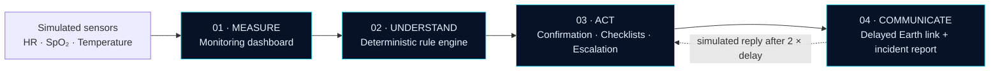

A single **simulated mission clock** drives everything: vital-sign playback (one sample every 10 s of mission time),
the analysis engine, the action log and the Earth-link queue. The header lets you **pause** or change the speed
(**1×, 10× default, 30×, 60×**), and the state is shared across all pages.

---

## 🧩 Modules

### 01 · MEASURE — Monitoring (`/`)

- Heart rate (bpm), SpO₂ (%) and body temperature (°C) with large live values.
- Trend chart per vital sign (last 10 min of mission time) with the **green demo reference band** and **dashed red caution limits**; out-of-range points are highlighted.
- Signal-quality bar and status for each simulated sensor: *Online · Degraded · No signal · Suspect · Excluded*.
- **Simulate incident**, **Simulate sensor fault** and **Reset to nominal** buttons, plus direct scenario selection.
- Every value is tagged **SIM** / *Simulated data*.

<p align="center"></p>

### 02 · UNDERSTAND — Analysis (`/analysis`)

- Overall **attention level**: `NOMINAL → ADVISORY → CAUTION → WARNING`.
- **Data reliability** score (overall and per vital sign) with the factors that lowered it.
- **Findings** in plain language, each with category (vital-sign deviation 🔴 or sensor issue 🟣), evidence, rule ID and onset time.
- List of deterministic rules, highlighting the ones currently **triggered**.
- **Event history**: detections, escalations, de-escalations and clearances with mission time.

<p align="center"></p>

### 03 · ACT — Response (`/response`)

- **Identified event** with level, category and onset time.
- **Measurement confirmation** for inconsistent readings: *Take confirmation reading* or *Unable to re-measure*.
- **Demonstration procedures** selected automatically (routine monitoring, sensor check, sensor artifact, vital-sign deviation, medical support request) as interactive checklists.
- **Medical support indicator** — *not required · keep monitoring · request · request now* — with the reasons and who to involve (Crew Medical Officer on board, flight surgeon on Earth).
- **Action log**: every step, confirmation and transmission is time-stamped and included in the report.

<p align="center"></p>

### 04 · COMMUNICATE — Earth Link (`/comms`)

- One-way delay slider **3–22 min** with presets (3 · 12 · 22 min), **round-trip estimate** and light-travel distance.
- **Link available / outage** toggle to show messages waiting in the queue.
- **Structured incident report** generated from the current state, previewed as text or JSON; priority pre-selected from the medical-support urgency.
- **Transmission queue & history** with a state stepper and progress bar per message, plus a **link view** that shows messages and acknowledgements travelling between Mars and Earth.
- Short **crew notes** can be queued as well.

<p align="center"></p>

### Science & Limits (`/science`)

- **Three content categories**, labelled everywhere: *Simulated data*, *Real scientific data & evidence* and *Demonstration rules*.
- **NASA Human Research Program evidence library** — official evidence reports on cardiovascular risk, hypoxia and medical capability, each with title, source, authors, date, links, the verbatim HRR risk statement, verbatim key quotes, how ASTRA Health uses it and its limitations; filterable by topic.
- **NASA OSDR dataset OSD-575** (Inspiration4 serum cardiovascular biomarker panel) with full source identification, per-timepoint summary chart and table, and an in-browser import for other OSDR files — never mixed with the simulated vital signs.
- Provenance table, provisional thresholds, scientific limitations and the AI tools & usage disclosure.

See [How scientific resources are used](#how-scientific-resources-are-used).

<p align="center">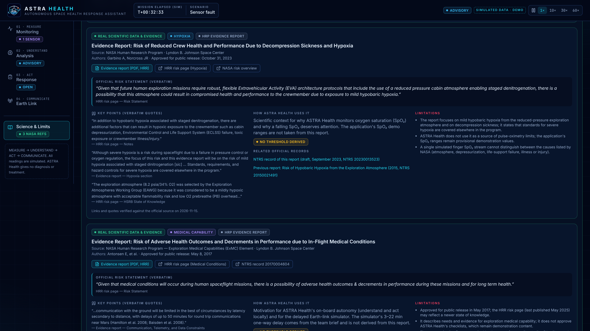</p>

---

## 🚀 Platform preview — FUTURE modules

Beside the tested demo, **Platform preview** (`/future`) shows how ASTRA Health can grow into an **autonomous space health decision-support system**: offline-first, evidence-based, human-in-the-loop and fully traceable. The five modules have their own state and on-device storage; they only *read* the simulated vital signs of the tested demo, which stays unchanged (its 77 tests and 14 browser checks are re-run on every change).

| Module | What it does |
|---|---|
| **F01 · Health Journal & Daily Check** (`/future/journal`) | Daily self-report (sleep, mood, fatigue, hydration, symptoms), routines with overdue / due status, 14-day trends, attention flags from versioned demonstration rules. |
| **F02 · Symptom Assessment & Evidence Engine** (`/future/assess`) | Structured questions → versioned rule set `ASTRA-SYM@0.1.0-demo` → attention level and next steps, with the journal facts and official NASA HRR references behind them, stated uncertainty and a mandatory human review. |
| **F03 · Space Health Profile** (`/future/profile`) | 9 domains (neuro-ocular, cardiovascular, renal, radiation, bone, vascular, immunological, emotional, sleep), 28 metrics with value, unit, time, origin, quality, trend and validation status. Exams that need unavailable equipment (e.g. intracranial pressure, bone density) show **no data** — never simulated. |
| **F04 · EVA & Autonomous Response** (`/future/eva`) | Pre / during / post-EVA checklists, equipment-conditioned steps, GO / HOLD proposal using F01 and F02, in-EVA events, commander decisions with mandatory reasons for overrides, prioritised Earth Link reports. |
| **F05 · Verification & Mission Readiness** (`/future/readiness`) | Crew data readiness (not a medical clearance), system checks, versioned rule sets with checksums, checksum-chained audit trail with tamper test and JSON export. |

Everything works with the Earth link lost: reports wait in a store-and-forward queue and leave in priority order (urgent → priority → routine) when it returns. A **service worker** keeps a copy of every page on the device, so after one online visit the whole app — tested demo included — **reloads with no network at all** (tested with the web server stopped). All rules and protocols are **PROVISIONAL demonstration content**, not NASA procedures and not clinically validated.

📘 [FUTURE documentation](docs/future/README.md) · 🎬 [Demo script](docs/future/DEMO_SCRIPT.md) · 🖼 [14 screenshots](docs/screenshots/future/README.md) · 🧪 [Test report](docs/future/TEST_REPORT.md) — 110 automated tests + 19 browser checks (incl. network cut, reload with the server stopped, phone/tablet layout) + full regression · ♿ [Accessibility audit](docs/ACCESSIBILITY.md)

<table>
  <tr>
    <td width="50%"><br/><sub><b>F02</b> — Versioned rules, evidence used and stated uncertainty</sub></td>
    <td width="50%">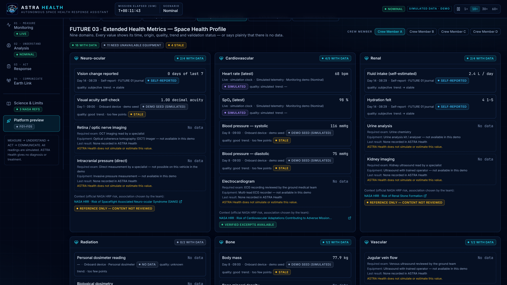<br/><sub><b>F03</b> — Nine domains; “No data” instead of simulated exams</sub></td>
  </tr>
  <tr>
    <td>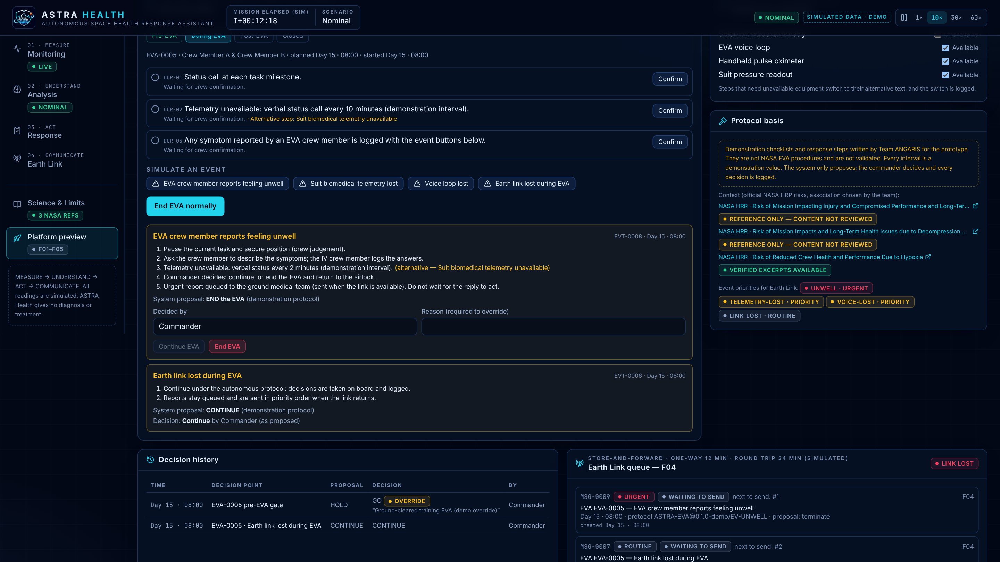<br/><sub><b>F04</b> — EVA without link or telemetry: alternative steps, commander decides</sub></td>
    <td><br/><sub><b>F05</b> — Checksum-chained audit trail and tamper test</sub></td>
  </tr>
</table>

---

## 🎬 Demonstration scenarios

| Scenario | What happens (simulated) | What ASTRA Health does |
|---|---|---|
| **1 — Nominal monitoring** | All values inside the demo ranges, good signal quality. The recording loops seamlessly. | `NOMINAL` · no findings · reliability **High** · routine-monitoring checklist · no medical support. A routine status report can still be sent. |
| **2 — Vital-sign deviation** | Heart rate rises (~72 → ~130 bpm), SpO₂ falls (~98 → ~88 %), temperature rises (~36.7 → ~37.8 °C); sensors stay healthy. | Detections → escalation to `WARNING` · reliability **High** (signals corroborate each other) · **Request medical support now** · escalation + safety checklists · **urgent** report through the delayed link. |
| **3 — Sensor fault** | The pulse oximeter reports erratic, very low SpO₂ with poor quality and dropouts while heart rate and temperature stay steady. | Sensor-issue findings and *reading inconsistent — confirmation needed* · reliability **Low** · medical support **not yet** required. A confirmation reading (98 %) attributes the values to the sensor → SpO₂ **excluded**, level drops to `ADVISORY`, sensor-hygiene checklist. If the crew cannot re-measure, medical support is recommended. |

At **10×**, the first detections appear after about **2 s** (sensor fault) or **9 s** (vital deviation) of real time, and
`WARNING` after about **15 s**. A presenter script is available in [docs/DEMO_SCRIPT.md](docs/DEMO_SCRIPT.md).

<table>
  <tr>
    <td width="50%">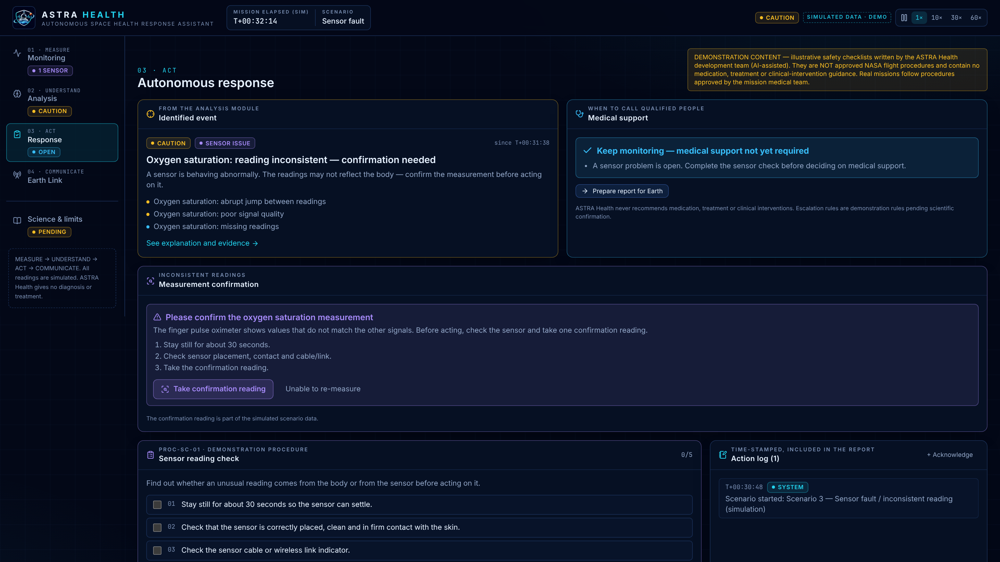<br/><sub>Scenario 3 — confirmation requested</sub></td>
    <td width="50%"><br/><sub>Scenario 3 — SpO₂ excluded as a sensor artifact</sub></td>
  </tr>
</table>

---

## 🎞 Full walkthrough — Scenario 2 (vital-sign deviation)

Sixteen 16:9 frames captured with the simulation paused at each step, from the baseline to the simulated reply from Earth
(12-min one-way delay). Source: [`docs/screenshots/sequence-vital-deviation/`](docs/screenshots/sequence-vital-deviation/).

<details>
<summary><b>Show all 16 frames</b></summary>
<br/>

<table>
  <tr>
    <td width="50%"><br/><sub><b>01 · MEASURE</b> — Baseline, nominal</sub></td>
    <td width="50%"><br/><sub><b>02 · MEASURE</b> — Incident simulated, values still normal</sub></td>
  </tr>
  <tr>
    <td><br/><sub><b>03 · MEASURE</b> — First deviation (SpO₂), CAUTION</sub></td>
    <td><br/><sub><b>04 · MEASURE</b> — Three vital signs out of range, WARNING</sub></td>
  </tr>
  <tr>
    <td><br/><sub><b>05 · UNDERSTAND</b> — Findings and data reliability</sub></td>
    <td><br/><sub><b>06 · UNDERSTAND</b> — Event history</sub></td>
  </tr>
  <tr>
    <td><br/><sub><b>07 · ACT</b> — Identified event, request medical support now</sub></td>
    <td>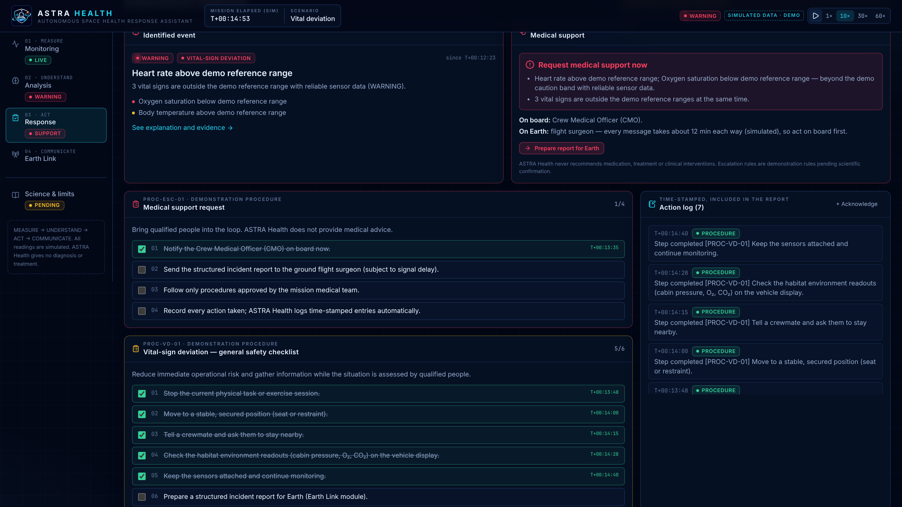<br/><sub><b>08 · ACT</b> — Checklists and action log</sub></td>
  </tr>
  <tr>
    <td>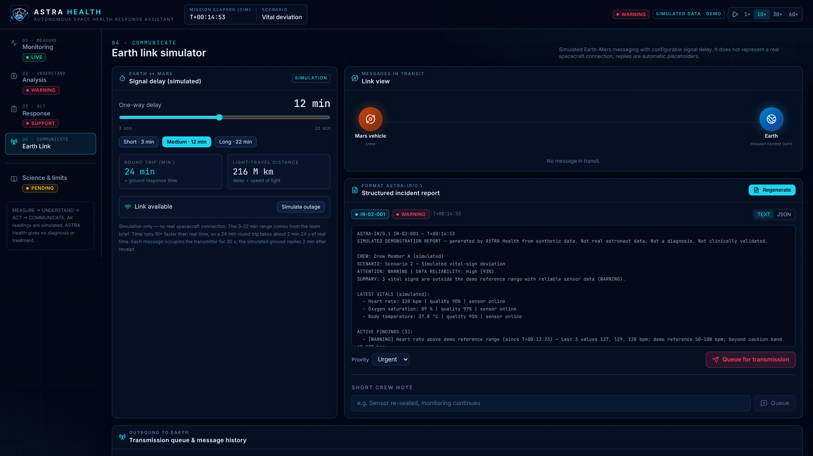<br/><sub><b>09 · COMMUNICATE</b> — Report generated (text)</sub></td>
    <td><br/><sub><b>10 · COMMUNICATE</b> — Report generated (JSON)</sub></td>
  </tr>
  <tr>
    <td><br/><sub><b>11 · COMMUNICATE</b> — Awaiting send</sub></td>
    <td><br/><sub><b>12 · COMMUNICATE</b> — Sent, in transit to Earth</sub></td>
  </tr>
  <tr>
    <td>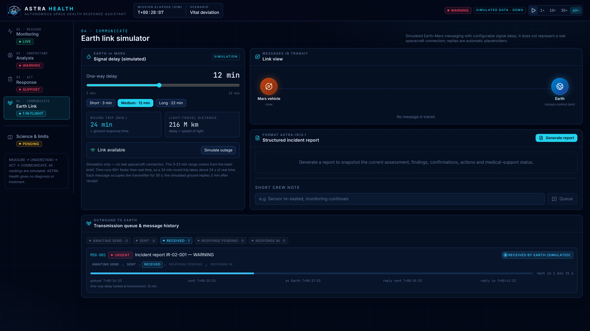<br/><sub><b>13 · COMMUNICATE</b> — Received by Earth (simulated)</sub></td>
    <td><br/><sub><b>14 · COMMUNICATE</b> — Response pending, reply in transit</sub></td>
  </tr>
  <tr>
    <td><br/><sub><b>15 · COMMUNICATE</b> — Simulated acknowledgement received</sub></td>
    <td><br/><sub><b>16 · ACT</b> — Checklists complete, full action log</sub></td>
  </tr>
</table>

</details>

---

## 🧠 Analysis engine

Pure, deterministic TypeScript functions (`src/lib/analysis`). The same input always produces the same output; no AI
model runs inside the application.

### Rules

Each vital sign is evaluated on the last 24 samples (4 min of mission time).

| Rule | Trigger | Category | Level |
|---|---|---|---|
| `VITAL_OUT_OF_RANGE` | 3 consecutive valid samples outside the demo range on the same side; cleared after 3 back inside (hysteresis) | 🔴 vital deviation | `CAUTION`; `WARNING` when the last 3 are beyond the caution band |
| `SENSOR_DROPOUT` | Missing readings in the last 10 samples | 🟣 sensor | `ADVISORY` (1) · `CAUTION` (≥ 2) |
| `SENSOR_IMPLAUSIBLE` | Value outside the physical plausibility limits | 🟣 sensor | `CAUTION` · confirmation needed |
| `SENSOR_ABRUPT_CHANGE` | Jump between consecutive readings above the maximum step | 🟣 sensor | `ADVISORY` (1) · `CAUTION` (≥ 2) · confirmation needed |
| `SENSOR_LOW_QUALITY` | Mean signal quality of the last 3 samples < 60 % (poor < 40 %) | 🟣 sensor | `ADVISORY` · `CAUTION` |
| `SENSOR_FLATLINE` | Heart rate exactly identical for 12 samples (2 min) | 🟣 sensor | `CAUTION` · confirmation needed |
| `READING_INCONSISTENT` | Out-of-range value while the same sensor is suspect — replaces the deviation | 🟣 sensor | `CAUTION` · confirmation needed |

### Attention levels

| Level | Meaning in the demo |
|---|---|
| 🟢 `NOMINAL` | Everything within the demo ranges, sensors reliable. |
| 🔵 `ADVISORY` | Be aware (e.g. a single dropout, or a sensor excluded after confirmation). |
| 🟡 `CAUTION` | Check the situation and follow the checklist. |
| 🔴 `WARNING` | A reliable vital-sign deviation beyond the caution band — request medical support. |

These are demonstration categories, **not clinical triage levels**.

### Data reliability

- Per vital sign: `signal quality × 100 − rule penalties` (dropout −5 each, abrupt change −10, implausible −20, frozen value −20), `+3` when two or more reliable deviations corroborate each other.
- **Overall = weakest vital sign** — one unreliable sensor is enough to lower trust in the whole picture.
- Labels: **High** ≥ 80 · **Medium** ≥ 55 · **Low** otherwise.
- Reliability describes **data quality**, not certainty about the crew member's health.

### Crew confirmation

| Outcome | Effect |
|---|---|
| **Artifact** — confirmation reading inside the demo range | The sensor's findings are resolved, the sensor is **excluded**, an `ADVISORY` remains. |
| **Confirmed** — reading also outside the range | *Inconsistent reading* becomes a confirmed vital-sign deviation. |
| **Unable to re-measure** | Findings stay open and medical support is recommended. |

### When to request medical support

| Urgency | Condition |
|---|---|
| **Request now** (`urgent`) | Any reliable vital-sign deviation at `WARNING`. |
| **Request** (`recommended`) | ≥ 2 simultaneous deviations · a deviation persisting ≥ 3 min · a confirmed deviation · an inconsistent reading that could not be verified. |
| **Keep monitoring** (`monitor`) | A single `CAUTION` deviation, or an open sensor issue (sensor check first). |
| **Not required** (`none`) | Nominal, or the abnormal reading was attributed to the sensor. |

ASTRA Health only says **when** to involve the Crew Medical Officer and the flight surgeon. It never says **what treatment** to apply.

---

## 📡 Earth–Mars communication simulator

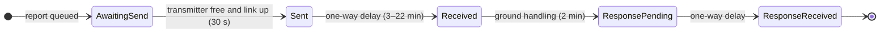

- One transmitter, **30 s** per message; order: **urgent → priority → routine**, then first in, first out.
- Messages wait while the link is **unavailable** (outage simulation) and leave as soon as it is restored.
- The one-way delay is **locked** when a message is transmitted, so moving the slider affects only new messages.
- The simulated ground station replies **2 min** after receipt with an automatic acknowledgement that states clearly that **no real person reviewed the content**.
- Round trip shown in the UI = `2 × one-way delay` (+ ground response time). Light-travel distance = `delay × speed of light`.

**Example from the walkthrough (12-min one-way delay):**

| Event | Mission time |
|---|---|
| Report queued | T+00:14:53 |
| Transmission complete — **sent** | T+00:15:23 |
| **Received** by Earth | T+00:27:23 |
| Ground reply sent — **response pending** | T+00:29:23 |
| **Response received** on board | T+00:41:23 |

---

## 🧾 Incident report (ASTRA-IR/0.1)

Generated from the live state on the Earth Link page and attached to the queued message. Excerpt of a real report produced
by the code for Scenario 2 (all values simulated):

```json
{
  "reportId": "IR-02-001",
  "format": "ASTRA-IR/0.1",
  "simulated": true,
  "disclaimer": "SIMULATED DEMONSTRATION REPORT — generated by ASTRA Health from synthetic data. Not real astronaut data. Not a diagnosis. Not clinically validated.",
  "generatedAt": "T+00:15:20",
  "crewMember": "Crew Member A (simulated)",
  "assessment": {
    "attentionLevel": "WARNING",
    "status": "vital-deviation",
    "summary": "3 vital signs are outside the demo reference range with reliable sensor data (WARNING).",
    "dataReliability": { "score": 96, "label": "High" }
  },
  "latestVitals": [
    { "vital": "hr", "value": "129", "unit": "bpm", "signalQuality": 0.93, "sensorStatus": "online" },
    { "vital": "spo2", "value": "89", "unit": "%", "signalQuality": 0.93, "sensorStatus": "online" },
    { "vital": "temp", "value": "37.8", "unit": "°C", "signalQuality": 0.97, "sensorStatus": "online" }
  ],
  "activeFindings": [
    {
      "title": "Heart rate above demo reference range",
      "level": "WARNING",
      "evidence": "Last 3 values 129, 129, 129 bpm; demo reference 50–100 bpm; beyond caution band 40–120 bpm.",
      "since": "T+00:11:50"
    }
  ],
  "actionsTaken": [
    { "at": "T+00:15:00", "text": "Step completed [PROC-ESC-01] Notify the Crew Medical Officer (CMO) on board now." }
  ],
  "medicalSupport": { "urgency": "urgent", "headline": "Request medical support now" },
  "requestToGround": "PRIORITY: Request flight surgeon review of the attached simulated data and guidance through approved procedures.",
  "scientificBasis": {
    "referenceRanges": "PROVISIONAL: Demonstration placeholder values chosen by the development team. Not clinically validated. …",
    "nasaResource": "Pending team confirmation — no NASA source for thresholds integrated yet.",
    "evidenceContext": "Context only, no threshold derived: 3 NASA HRP evidence reports (cardiovascular, hypoxia, medical capability) listed in Science & Limits."
  }
}
```

The full report also contains every finding, resolved findings, confirmations, every logged action and the reasons behind
the medical-support decision. A plain-text version is transmitted as the message body.

---

## 🏗 Architecture

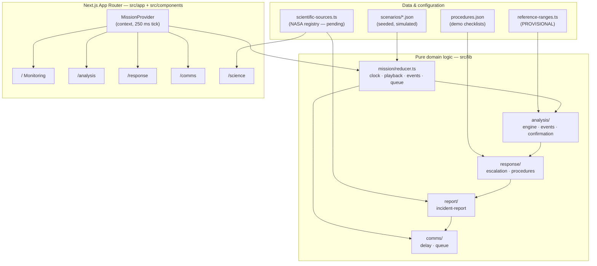

**Design principles**

- **Pure core, thin UI** — all domain logic is pure and typed; React components only render derived state and dispatch actions, so the complete loop is testable without a browser.
- **One simulated clock** — consistent timestamps across monitoring, analysis, actions and messages.
- **Configuration over code** — thresholds, NASA registry, scenarios and procedures are data that can be replaced without touching the engines.
- **Honest by construction** — tests fail if a NASA resource is claimed without full provenance, or if procedures mention medication or clinical interventions.

<details>
<summary><b>Project structure</b></summary>

```text
astrahealth/
├── src/
│   ├── app/                      # Routes: / · /analysis · /response · /comms · /science
│   │   ├── layout.tsx            # MissionProvider + AppShell
│   │   ├── icon.png · apple-icon.png · opengraph-image.png
│   │   └── globals.css           # Theme tokens (navy / cyan, alert colours)
│   ├── components/
│   │   ├── layout/               # Header, sidebar navigation, logo
│   │   ├── ui/                   # Panel, Badge, Button, ProgressBar, tone maps
│   │   └── monitor/ · analysis/ · response/ · comms/ · science/
│   ├── state/MissionProvider.tsx # React context + simulation clock
│   ├── lib/
│   │   ├── mission/reducer.ts    # Pure state machine
│   │   ├── analysis/             # Rule engine, event diffing, crew confirmation
│   │   ├── response/             # Escalation + procedure selection
│   │   ├── comms/                # Delay maths + transmission queue
│   │   ├── report/               # ASTRA-IR/0.1 incident report
│   │   └── scenarios.ts · time.ts · types.ts
│   │   └── science/              # Evidence & OSDR types, OSDR parser/summariser
│   ├── config/
│   │   ├── reference-ranges.ts   # PROVISIONAL thresholds
│   │   ├── scientific-sources.ts # NASA registry for a threshold source (pending)
│   │   ├── evidence-library.ts   # Typed access to the NASA HRP evidence library
│   │   └── data-provenance.ts    # Simulated / real / demo-rule classification
│   ├── data/
│   │   ├── scenarios/*.json      # SIMULATED recordings (180 samples × 10 s)
│   │   ├── science/nasa-hrp-evidence.json # NASA HRP evidence (verified links + verbatim quotes)
│   │   ├── osdr/OSD-575.json     # REAL NASA OSDR file, stored verbatim + SHA-256
│   │   └── procedures.json       # Demonstration checklists
│   └── assets/astra-emblem.png
├── tests/                        # Vitest: acceptance (test plan), engine, comms, science, UI
├── scripts/                      # Data generator, OSDR import, link check, screenshots, banners
├── docs/                         # Architecture, limitations, NASA guide, demo script, images
├── public/brand/astra-health-logo.png
├── AI_DISCLOSURE.md
└── README.md · README.pt-BR.md
```

</details>

More detail: [docs/ARCHITECTURE.md](docs/ARCHITECTURE.md).

---

## 🛠 Tech stack

| Layer | Technology |
|---|---|
| Framework | [Next.js 16](https://nextjs.org) (App Router, Cache Components, Turbopack) · React 19 |
| Language | TypeScript (strict) |
| Styling | Tailwind CSS 4 — dark navy & cyan theme, distinct alert colours |
| Charts | Recharts 3 |
| Icons | Lucide |
| Tests | Vitest 5 · Testing Library · jsdom |
| Tooling | ESLint (Next.js core-web-vitals + TypeScript) · Playwright (screenshots and banners only) |
| Hosting | Vercel |

No authentication, no database, no external APIs and no environment variables. Simulated data lives in JSON.

---

## 🚀 Getting started

**Requirements:** Node.js **≥ 20.9** and npm.

```bash
git clone https://github.com/recpires/astrahealth.git
cd astrahealth
npm install
npm run dev
# open http://localhost:3000
```

**First steps in the app**

1. Watch scenario 1 (nominal) on **Monitoring**.
2. Press **Simulate incident** (scenario 2) or **Simulate sensor fault** (scenario 3).
3. Follow the sidebar: **Analysis → Response → Earth Link**.
4. Use the header controls to pause or change the speed; **Reset to nominal** starts over.

### npm scripts

| Command | Description |
|---|---|
| `npm run dev` | Development server on http://localhost:3000 |
| `npm run build` / `npm run start` | Production build / production server |
| `npm test` | Run all automated tests once |
| `npm run test:watch` | Tests in watch mode |
| `npm run lint` | ESLint |
| `npm run typecheck` | Generate route types and run `tsc --noEmit` |
| `npm run generate:data` | Regenerate the simulated scenarios (seeded, reproducible) |
| `npm run screenshots` | 15 presentation screenshots → `docs/screenshots/` ¹ |
| `npm run screenshots:sequence` | 16-frame Scenario 2 walkthrough → `docs/screenshots/sequence-vital-deviation/` ¹ |
| `npm run screenshots:future` | 14 FUTURE screenshots following the demo script → `docs/screenshots/future/` (starts its own server) ² |
| `npm run banners` | README banners (EN / PT) → `docs/assets/` ² |
| `npm run osdr:import -- OSD-575` | Import a public NASA OSDR file into `src/data/osdr/` (`--list`, `--file <name>`) ³ |
| `npm run science:check-links` | Check every evidence-library and OSDR link against the official servers ³ |
| `python3 scripts/verify-science-sources.py` | Independent verification of quotes, file integrity, units and statistics (needs `pip install pypdf`) ³ |
| `npm run test:evidence` | Full test suite + machine-readable results and acceptance evidence → `docs/test-results/` |
| `npm run test:e2e` | Browser checks of the three scenarios against the production build, with screenshots (run `npm run build` first) ² |
| `npm run test:report` | Regenerates the scenario test report (`docs/TEST_REPORT.md`, `docs/TEST_REPORT.pt-BR.md`) from the results |
| `npm run generate:future` | Regenerate the FUTURE demo seed (journal, device readings) |
| `npm run future:check-refs` | Check the NASA HRR risk references of the FUTURE modules against the official index (`-- --write-snapshot` refreshes the offline snapshot) ³ |
| `npm run test:future` | FUTURE unit, integration and interface tests + JSON results → `docs/test-results/future/` |
| `npm run test:e2e:future` | FUTURE browser checks (F01–F05, network cut, reload, export) against the production build ² |
| `npm run test:regression` / `npm run test:e2e:regression` | The original 77 tests / 14 scenario browser checks, results → `docs/test-results/future/regression/` |
| `npm run test:report:future` | Regenerates `docs/future/TEST_REPORT.md` and `.pt-BR.md` from the results |
| `npm run test:a11y` | Accessibility audit (axe-core WCAG 2.2 A/AA on every page, desktop + phone + interactive states, keyboard pass) → `docs/ACCESSIBILITY.md` ² |

¹ Needs a running server (`BASE_URL`, default `http://localhost:3000`) and Playwright with Chromium.
² Needs Playwright with Chromium.
³ Needs internet access to NASA servers; behind an HTTP proxy prefix with `NODE_USE_ENV_PROXY=1`.

---

## 🧪 Testing

### Scenario test report

The three demonstration scenarios are tested against a written test plan and the results are published in
**[docs/TEST_REPORT.md](docs/TEST_REPORT.md)** ([Português](docs/TEST_REPORT.pt-BR.md)), generated from machine-readable results:

| Layer | What runs | Evidence |
|---|---|---|
| Test plan | 17 cases (S1-01 … S3-06), each linked to a step of the brief (MEASURE · UNDERSTAND · ACT · COMMUNICATE) and an expected result | [`tests/acceptance/test-plan.json`](tests/acceptance/test-plan.json) |
| Acceptance tests | Each case played end to end on the deterministic mission engine; observed values recorded (detection times, levels, message timelines…) | [`acceptance-evidence.json`](docs/test-results/acceptance-evidence.json) |
| Browser checks | 14 checks clicking through the three scenarios in Chromium against the production build | [`e2e-results.json`](docs/test-results/e2e-results.json) + [screenshots](docs/test-results/e2e/) |

```bash
npm run test:evidence && npm run build && npm run test:e2e && npm run test:report
```

### Unit and integration tests

```bash
npm test
```

**77 tests in 8 files**, all deterministic and offline:

| File | What it covers |
|---|---|
| `tests/acceptance/scenarios.acceptance.test.ts` | The 17 test-plan cases: end-to-end MEASURE → UNDERSTAND → ACT → COMMUNICATE flow of each scenario (detections and their timing, escalation, procedures, confirmation, action log, report contents, queue priority and every message state). |
| `tests/analysis.test.ts` | Each rule (persistence/hysteresis, dropout, plausibility, rate of change, quality, frozen value, cross-check), reliability, events, confirmation outcomes and absence of diagnostic wording. |
| `tests/comms.test.ts` | Delay limits, round trip, light-travel distance, FIFO and priority queue, outage, delay locking and state timeline. |
| `tests/science.test.ts` | Guards: no NASA threshold source claimed while pending; provisional labels; procedures free of medication and clinical-intervention terms; AI disclosure shown on the Science page. |
| `tests/evidence.test.ts` | Evidence library: all three topics covered; title, source, date, PDF link and limitations present; official NASA HTTPS hosts only; no threshold derived and no NASA-approval claim; provenance classification. |
| `tests/osdr.test.ts` | OSDR parser (CSV edge cases, timepoints, summaries, errors); bundled OSD-575 snapshot matches its SHA-256; statistics equal an independent Python computation from the OSDR submitted file; real data never imported by the simulation modules. |
| `tests/ui/science.test.tsx` | Science & Limits page: three categories, evidence cards and topic filter, OSDR source identification, file import (valid, invalid, missing accession). |
| `tests/ui/modules.test.tsx` | The four modules rendered with Testing Library: incident buttons, findings, confirmation, checklist logging, delay presets, report generation and queuing, unverified sensor values. |

Since the FUTURE modules were added, `npm test` runs **187 tests in 18 files**: the 77 above, unchanged, plus 110 in `tests/future/` (see the [FUTURE test report](docs/future/TEST_REPORT.md)).

### Accessibility

`npm run test:a11y` runs axe-core (WCAG 2.0, 2.1 and 2.2, levels A and AA) on all 11 pages at desktop and phone widths and in 7 interactive states (incident running, report generated, assessment result, EVA event…), then tabs through every page checking that focus is visible, not hidden behind the sticky header and never trapped. Result: **0 violations, 0 keyboard problems** — see [docs/ACCESSIBILITY.md](docs/ACCESSIBILITY.md) for the details, what was fixed and the limits (no screen-reader session yet).

Quality gates run before each commit: `npm test`, `npm run lint`, `npm run typecheck`, `npm run build`.

---

## 🖼 Screenshots & banners

All images are captured from the running application (not mock-ups) in **16:9** frames suitable for slides:

- [`docs/screenshots/`](docs/screenshots/) — 15 captures covering the three scenarios and the Science & Limits section (2880 × 1620 px).
- [`docs/screenshots/sequence-vital-deviation/`](docs/screenshots/sequence-vital-deviation/) — the 16-frame walkthrough above, with captions.
- [`docs/screenshots/future/`](docs/screenshots/future/README.md) — 14 captures of the FUTURE modules following the [demo script](docs/future/DEMO_SCRIPT.md), including a phone capture and a reload with the server stopped (captions in English and Portuguese).
- [`docs/assets/`](docs/assets/) — README banners in English and Portuguese, rendered from `scripts/banner/banner.html`.

---

## ☁ Deployment (Vercel)

The application prerenders every route as static content and needs **no environment variables**.

[](https://vercel.com/new/clone?repository-url=https%3A%2F%2Fgithub.com%2Frecpires%2Fastrahealth)

1. Push the repository to GitHub.
2. On Vercel: **Add New… → Project → Import** the repository.
3. Keep the detected **Next.js** preset (build command `next build`, Node.js 20+).
4. **Deploy.**

From the command line: `npx vercel` (preview) and `npx vercel --prod` (production).

---

## 🔬 Scientific basis & limitations

### How scientific resources are used

ASTRA Health keeps three kinds of content strictly apart and labels them everywhere in **Science & Limits**:

| Category | What | Where in the code | Used for |
|---|---|---|---|
| 🟦 **Simulated data** | Vital-sign streams, signal quality, dropouts, confirmation reading, ground acknowledgement | `src/data/scenarios/*.json` (seeded generator) | Monitoring, Analysis, Response, Earth Link |
| 🟩 **Real scientific data & evidence** | NASA HRP evidence reports; NASA OSDR dataset OSD-575 | `src/data/science/nasa-hrp-evidence.json`, `src/data/osdr/` | Science & Limits only — context and display |
| 🟨 **Demonstration rules** | Reference ranges, analysis rules, escalation, checklists, Earth-link timings | `src/config/reference-ranges.ts`, `src/lib/`, `src/data/procedures.json` | Analysis, Response, Earth Link |

#### NASA Human Research Program evidence library

| Topic | Evidence report | Source · date | Links |
|---|---|---|---|
| Cardiovascular | *Evidence Report: Risk of Cardiovascular Adaptations Contributing to Adverse Mission Performance and Health Outcomes* | NASA HRP, Human Health and Countermeasures Element, JSC · approved for public release Dec 15, 2022 | [PDF](https://humanresearchroadmap.nasa.gov/evidence/reports/Cardio%20Risk%20EB%202022%20FINAL_4-3-2023.pdf) · [HRR risk](https://humanresearchroadmap.nasa.gov/Risks/?i=179) · [NASA overview](https://www.nasa.gov/directorates/esdmd/hhp/cv-risk/) |
| Hypoxia | *Evidence Report: Risk of Reduced Crew Health and Performance Due to Decompression Sickness and Hypoxia* | NASA HRP, JSC · approved for public release Oct 31, 2023 | [PDF](https://humanresearchroadmap.nasa.gov/evidence/reports/Evidence%20Report%20Hypoxia%20and%20DCS_FINAL_1-8-2024.pdf) · [HRR risk](https://humanresearchroadmap.nasa.gov/Risks/?i=173) · [NASA overview](https://www.nasa.gov/directorates/esdmd/hhp/risk-of-reduced-crew-health-and-performance-due-to-hypoxia/) |
| Medical capability | *Evidence Report: Risk of Adverse Health Outcomes and Decrements in Performance due to In-Flight Medical Conditions* | NASA HRP, Exploration Medical Capabilities Element, JSC · approved for public release May 8, 2017 | [PDF](https://humanresearchroadmap.nasa.gov/evidence/reports/Medical.pdf) · [HRR risk](https://humanresearchroadmap.nasa.gov/Risks/?i=95) · [NTRS](https://ntrs.nasa.gov/citations/20170004604) |

- Titles, dates and authors were checked against the PDFs on the Human Research Roadmap and the NASA Technical Reports Server; risk statements are copied verbatim from the HRR risk pages and key points are verbatim quotes. Last verified on 2026-11-15 — re-check at any time with `npm run science:check-links`.
- The evidence is used **as scientific context only**. Every entry has `derivesThresholds: false` (enforced by a test): no threshold, alarm level, rule or checklist in ASTRA Health comes from it, and no checklist is presented as NASA-approved.
- Each entry shows its **limitations** in the app (for example, the cardiovascular report states that it is inconclusive whether spaceflight causes or increases dysrhythmias).

#### NASA OSDR dataset — OSD-575

- **Study:** *SpaceX Inspiration4 Blood Serum Metabolic Panel and Immune/Cardiac Cytokine Arrays (Comprehensive Metabolic Panel and Multiplex)* — public release 14 May 2024 — [osdr.nasa.gov/bio/repo/data/studies/OSD-575](https://osdr.nasa.gov/bio/repo/data/studies/OSD-575).
- **File:** `LSDS-8_Multiplex_serum_cardiovascular_EvePanel_TRANSFORMED.csv` (ALSDA Transformed Files): 4 crew members × 7 timepoints (L-92 … R+194) × 9 cardiovascular serum biomarkers.
- **Import:** `npm run osdr:import -- OSD-575` downloads the file through the official OSDR API and stores it **verbatim** in `src/data/osdr/OSD-575.json` with accession, title, study and download URLs, public-release date, mission, publications (DOIs), retrieval date and **SHA-256** (a test re-checks it). Use `--list` to see a study's files and `--file <name>` to choose another one.
- **In-app import:** *Science & Limits → Import another OSDR file* reads an OSDR multiplex table selected by the user, requires the OSDR accession, and keeps it **only in the browser** (not saved).
- **Separation:** OSDR data lives in `src/data/osdr/`, apart from `src/data/scenarios/`; the simulation, analysis and report modules never import it (tested). The page shows **summary statistics only** (n, mean, min, max per timepoint) — no per-person values, no reference ranges and no clinical interpretation.
- **Why no live download in the browser:** the OSDR API only accepts browser requests from `osdr.nasa.gov` (CORS), so the import runs as a command-line step or from a local file.

#### Verification

Verified on 2026-11-15 against freshly downloaded official files — full report in
[docs/SCIENCE_VERIFICATION.md](docs/SCIENCE_VERIFICATION.md):

- **Links:** 17/17 answer on the official servers (`npm run science:check-links`).
- **Texts:** titles, dates and authors (9/9), risk statements (3/3) and key quotes (10/10) found verbatim in the official PDFs and HRR pages.
- **OSD-575 file:** the stored copy is byte-for-byte identical to a fresh download (SHA-256); all 252 values and the 9 units match the *submitted* results file declared in the study's ISA metadata.
- **Statistics:** n, mean, min and max for 63 analyte × timepoint groups recomputed independently in Python from the submitted file — identical to the app's results (largest relative difference 2.1 × 10⁻¹⁶); the comparison also runs offline in `npm test`.
- **Negative control:** deliberately altered copies (a reversed quote, one changed digit, a 0.1 % statistic error) were all detected.
- Re-run everything with `python3 scripts/verify-science-sources.py` (Python 3 + `pip install pypdf`).

This verification covers the **accuracy of the sources, the file and the calculations**. It does **not** validate the
analysis engine's thresholds, which remain provisional (next section).

#### Source for analysis thresholds — *pending team confirmation*

None of the resources above defines ASTRA Health's numeric limits. The registry in `src/config/scientific-sources.ts`
remains reserved for a NASA source of thresholds and stays empty until Team ANGARIS confirms the official challenge
statement; once confirmed it must record the source's **name, origin, URL/DOI, version, access date and effective use**
— a test enforces it. Step-by-step guide: [docs/NASA_RESOURCE.md](docs/NASA_RESOURCE.md).

### Provisional demo thresholds

From `src/config/reference-ranges.ts` (status **PROVISIONAL** — placeholder values chosen by the development team, not
clinically validated, not from a NASA source):

| Vital sign | Demo reference | Caution band | Plausibility limits | Max step / 10 s |
|---|---|---|---|---|
| Heart rate | 50–100 bpm | 40–120 bpm | 25–230 bpm | 30 bpm |
| SpO₂ | 95–100 % | 90–100 % | 50–100 % | 6 % |
| Body temperature | 36.0–37.5 °C | 35.5–38.0 °C | 30–43 °C | 0.6 °C |

### Key limitations

- All **vital signs** are **synthetic**, produced by a seeded generator (`scripts/generate-scenarios.mjs`). The only real measurements are the NASA OSDR summaries in Science & Limits, which come from four private astronauts on a 3-day low-Earth-orbit mission and are not representative of long-duration Mars missions.
- The NASA evidence library is cited as context; the official documents remain the authoritative source and may be updated by NASA.
- Rules, levels, reliability scores and escalation triggers are **demonstration choices** without clinical validation.
- Procedures are **illustrative** safety checklists, not approved flight procedures, and never include medication or treatment.
- The Earth–Mars delay range (3–22 min) comes from the team brief; real delay depends on planetary geometry and the link can be unavailable for long periods. Ground replies are automatic placeholders.
- Only three scenarios are modelled; real physiology and sensor artifacts are far more varied.
- No authentication, persistence, encryption or medical-device quality processes. State resets on reload.

Full list: [docs/SCIENTIFIC_LIMITATIONS.md](docs/SCIENTIFIC_LIMITATIONS.md).

---

## 🗺 Roadmap

Possible next steps (not commitments):

- [ ] Confirm the challenge statement and, if a NASA source of numeric limits applies, register it and derive thresholds from it.
- [ ] Expert review of the rules, escalation logic and checklist wording.
- [ ] Sensor adapter interface for real wearables (replacing the JSON playback).
- [x] Persistent, exportable decision log — FUTURE 05 audit trail (preview).
- [ ] Ephemeris-based Earth–Mars delay and conjunction blackout windows; bandwidth model.
- [x] Multi-crew view — FUTURE 01 / FUTURE 05 (preview); Crew Medical Officer console still open.
- [ ] Expert review of the FUTURE rule sets and protocols, with change control.
- [x] Automated accessibility audit (axe-core WCAG 2.2 A/AA + keyboard) — [docs/ACCESSIBILITY.md](docs/ACCESSIBILITY.md).
- [x] Full offline operation, including a reload with no network (service worker).
- [ ] Fully bilingual interface (EN / PT-BR) and a screen-reader review.

---

## 🤖 AI Tools & Usage Disclosure

Team ANGARIS used AI-assisted tools, including Claude Code, Codex, and ChatGPT, as applicable, to support software development, code review, documentation, and presentation preparation.

The project’s concept, technical decisions, testing, and final validation are the responsibility of Team ANGARIS.

All physiological data presented in the prototype are simulated. ASTRA Health is an experimental demonstration and is not a clinically validated medical device.

Additional notes:

- **Logo** — the ASTRA Health logo is an AI-generated image. The original file keeps its *AI-generated* label (`public/brand/astra-health-logo.png`) and is shown with it in the banners; the header emblem, favicon and share image are crops of it.
- **Inside the app** — no AI model runs in the application; all analysis is deterministic and rule-based.

Details: [AI_DISCLOSURE.md](AI_DISCLOSURE.md).

---

## 👥 Team

**Team ANGARIS** — NASA Space Apps Challenge 2026.

| Name | GitHub |
|---|---|
| Rodrigo Eufrásio Costa Pires | [recpires](https://github.com/recpires) |
| Vinicius Gomes Jeronimo | [vinnlacoste](https://github.com/vinnlacoste) |
| Jecika Lilia Cavalcante e Silva Saito | [jecikasaito](https://github.com/jecikasaito) |
| Diego Felippe Scorsi Prado | [Dprado93](https://github.com/Dprado93) |
| Yvna Marçal Sousa Rosa | [YVNAROSA](https://github.com/YVNAROSA) |
| Kennedy Teixeira da Silva | [KennedyTeixeira](https://github.com/KennedyTeixeira) |

## 📄 License

Released under the [MIT License](LICENSE) — Copyright (c) 2026 Team ANGARIS.

The license covers the code and documentation written by the team. Third-party material keeps its own terms:

- **NASA content** — the Human Research Program evidence excerpts and Human Research Roadmap risk titles (`src/data/science/`, `src/data/future/`) and the OSDR OSD-575 data snapshot (`src/data/osdr/`) come from public NASA sources, identified in each record.
- **Dependencies** — Next.js, React, Recharts, Lucide and the other npm packages are distributed under their own licenses (Lucide icons: ISC, with the icons derived from Feather under MIT).

## 🙏 Acknowledgements

- The **NASA Space Apps Challenge** organisers and community.
- The open-source projects that make this prototype possible: Next.js, React, Tailwind CSS, Recharts, Lucide, Vitest, Testing Library and Playwright.

<sub>ASTRA Health is a hackathon project. It is not affiliated with or endorsed by NASA. All vital-sign data is simulated.</sub>
