<p align="center">
  
</p>

<p align="center">
  <a href="README.md">English</a> · <strong>Português (Brasil)</strong>
</p>

<p align="center">
  
  
  
  
  
  
  
  <br/>
  
  
  
</p>

<p align="center">
  O <b>ASTRA Health</b> ajuda astronautas em missões de longa duração a <b>compreender alterações nos sinais vitais</b>
  e a <b>seguir procedimentos previamente definidos</b> a bordo — mesmo quando cada mensagem para a Terra leva minutos para chegar.
</p>

> [!WARNING]
> **Protótipo demonstrativo.** Todos os valores de sinais vitais deste projeto são **simulados**. O ASTRA Health **não é
> um dispositivo médico**, **não faz diagnóstico**, **não recomenda medicamentos, tratamentos nem intervenções clínicas** e
> **não possui validação clínica**. Os limites de análise são **valores provisórios** até que a Equipe ANGARIS confirme o
> enunciado oficial do desafio e o recurso científico da NASA. Veja [Base científica e limitações](#-base-científica-e-limitações).

---

## 📑 Sumário

1. [Visão geral](#-visão-geral)
2. [O problema](#-o-problema)
3. [Como funciona](#-como-funciona)
4. [Módulos](#-módulos)
5. [Cenários de demonstração](#-cenários-de-demonstração)
6. [Sequência completa — Cenário 2](#-sequência-completa--cenário-2-alteração-dos-sinais-vitais)
7. [Motor de análise](#-motor-de-análise)
8. [Comunicação Terra–Marte](#-simulador-de-comunicação-terramarte)
9. [Relatório de incidente (ASTRA-IR/0.1)](#-relatório-de-incidente-astra-ir01)
10. [Arquitetura](#-arquitetura)
11. [Tecnologias](#-tecnologias)
12. [Como executar](#-como-executar)
13. [Testes](#-testes)
14. [Capturas de tela e banners](#-capturas-de-tela-e-banners)
15. [Publicação (Vercel)](#-publicação-vercel)
16. [Base científica e limitações](#-base-científica-e-limitações)
17. [Roadmap](#-roadmap)
18. [Declaração de uso de ferramentas de IA](#-declaração-de-uso-de-ferramentas-de-ia)
19. [Equipe, licença e agradecimentos](#-equipe)

---

## 🛰 Visão geral

O **ASTRA Health — Autonomous Space Health Response Assistant** (Assistente Autônomo de Resposta em Saúde Espacial) é um
MVP web desenvolvido pela **Equipe ANGARIS** para o **NASA Space Apps Challenge 2026**. Ele demonstra um ciclo fechado
de quatro etapas:

| Etapa | Módulo | Pergunta que responde |
|:---:|---|---|
| **01 · MEDIR** | Monitoramento | *Como estão meus sinais vitais agora? Os sensores estão funcionando?* |
| **02 · ENTENDER** | Análise | *Algo mudou? É o corpo ou o sensor? Quanto posso confiar nos dados?* |
| **03 · AGIR** | Resposta | *Que passos predefinidos devo seguir? Preciso pedir suporte médico?* |
| **04 · COMUNICAR** | Link com a Terra | *Como aviso a Terra e quando posso esperar uma resposta?* |

**Destaques**

- 📈 Monitoramento simulado em tempo real de frequência cardíaca, SpO₂ e temperatura corporal, com gráficos de tendência e estado dos sensores.
- 🧠 Motor de regras determinístico e explicável — cada achado vem com explicação em linguagem simples e evidências.
- 🟣 Falhas de sensor são detectadas e exibidas em outra cor, para que um sensor com defeito nunca seja confundido com uma emergência médica.
- ✅ Confirmação de medições inconsistentes pelo astronauta, checklists de segurança demonstrativos e registro de ações com horário.
- 🚨 Indicação clara de **quando** pedir suporte médico — sem jamais recomendar tratamento.
- 📡 Simulador do link Terra–Marte com atraso de 3 a 22 min por sentido, fila de transmissão, simulação de queda do link e estados de mensagem.
- 🧾 Relatório de incidente estruturado (texto + JSON) gerado a partir do estado atual.
- 🧪 52 testes automatizados, incluindo o fluxo completo dos três cenários.

---

## 🧭 O problema

Numa missão a Marte, um sinal de rádio leva aproximadamente **de 3 a 22 minutos para percorrer um único sentido** (faixa
definida no briefing da equipe). Uma pergunta ao médico de voo na Terra e sua resposta podem levar, portanto, **de 6 a 44
minutos**, além do tempo que a equipe em solo precisa para responder. Nesse intervalo, a tripulação precisa:

1. perceber que algo está mudando,
2. distinguir uma **alteração fisiológica real** de um **problema de sensor**,
3. seguir ações **seguras e predefinidas** a bordo, e
4. enviar à Terra um resumo **claro e estruturado**, útil quando finalmente chegar.

O ASTRA Health prototipa esse fluxo de trabalho com dados simulados.

---

## ⚙ Como funciona

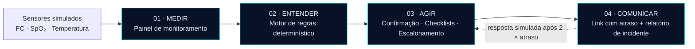

Um único **relógio simulado da missão** comanda tudo: a reprodução dos sinais vitais (uma amostra a cada 10 s de tempo de
missão), o motor de análise, o registro de ações e a fila do link com a Terra. No cabeçalho é possível **pausar** ou mudar a
velocidade (**1×, 10× por padrão, 30×, 60×**), e o estado é compartilhado entre todas as páginas.

> A interface da aplicação está em **inglês** para a demonstração; nesta documentação, os nomes de botões e telas aparecem
> como na interface.

---

## 🧩 Módulos

### 01 · MEDIR — Monitoramento (`/`)

- Frequência cardíaca (bpm), SpO₂ (%) e temperatura corporal (°C) com valores em destaque.
- Gráfico de tendência por sinal vital (últimos 10 min de missão) com a **faixa de referência demonstrativa em verde** e os **limites de cautela tracejados em vermelho**; pontos fora da faixa são destacados.
- Barra de qualidade de sinal e estado de cada sensor simulado: *Online · Degraded · No signal · Suspect · Excluded*.
- Botões **Simulate incident** (simular incidente), **Simulate sensor fault** (simular falha de sensor) e **Reset to nominal** (voltar ao normal), além da seleção direta de cenário.
- Todo valor é identificado como **SIM** / *Simulated data*.

<p align="center"></p>

### 02 · ENTENDER — Análise (`/analysis`)

- **Nível de atenção** geral: `NOMINAL → ADVISORY → CAUTION → WARNING`.
- Índice de **confiabilidade dos dados** (geral e por sinal vital), com os fatores que o reduziram.
- **Achados** em linguagem simples, cada um com categoria (alteração de sinal vital 🔴 ou problema de sensor 🟣), evidências, ID da regra e horário de início.
- Lista das regras determinísticas, destacando as que estão **acionadas**.
- **Histórico de eventos**: detecções, escalonamentos, reduções de nível e normalizações, com horário da missão.

<p align="center"></p>

### 03 · AGIR — Resposta (`/response`)

- **Evento identificado**, com nível, categoria e horário de início.
- **Confirmação de medição** para leituras inconsistentes: *Take confirmation reading* (fazer leitura de confirmação) ou *Unable to re-measure* (não foi possível medir de novo).
- **Procedimentos demonstrativos** selecionados automaticamente (monitoramento de rotina, verificação de sensor, artefato de sensor, alteração de sinais vitais, pedido de suporte médico) como checklists interativos.
- **Indicador de suporte médico** — *não necessário · continuar monitorando · solicitar · solicitar agora* — com os motivos e quem acionar (Oficial Médico da Tripulação a bordo, médico de voo na Terra).
- **Registro de ações**: cada passo, confirmação e transmissão recebe horário e entra no relatório.

<p align="center">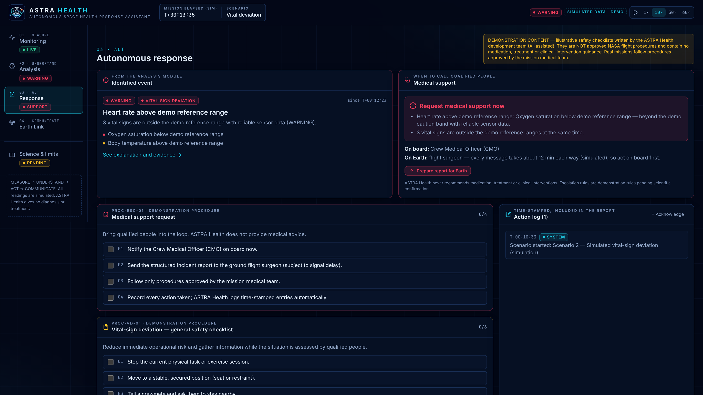</p>

### 04 · COMUNICAR — Link com a Terra (`/comms`)

- Controle de atraso por sentido de **3 a 22 min**, com atalhos (3 · 12 · 22 min), **estimativa de ida e volta** e distância percorrida pela luz.
- Alternância **link disponível / indisponível**, para mostrar mensagens aguardando na fila.
- **Relatório de incidente estruturado** gerado a partir do estado atual, com prévia em texto ou JSON; prioridade pré-selecionada conforme a urgência de suporte médico.
- **Fila de transmissão e histórico**, com indicador de estado e barra de progresso por mensagem, além de uma **visão do link** mostrando mensagens e confirmações viajando entre Marte e a Terra.
- Também é possível enviar **notas curtas da tripulação**.

<p align="center"></p>

### Ciência e limitações (`/science`)

Registro do recurso da NASA (confirmação pendente), limites provisórios, limitações científicas, origem dos dados simulados
e declaração de uso de IA — tudo dentro do aplicativo.

---

## 🎬 Cenários de demonstração

| Cenário | O que acontece (simulado) | O que o ASTRA Health faz |
|---|---|---|
| **1 — Monitoramento normal** | Todos os valores dentro das faixas demonstrativas, boa qualidade de sinal. A gravação se repete sem emendas. | `NOMINAL` · nenhum achado · confiabilidade **High** · checklist de monitoramento de rotina · sem suporte médico. Ainda é possível enviar um relatório de status de rotina. |
| **2 — Alteração de sinais vitais** | A frequência cardíaca sobe (~72 → ~130 bpm), a SpO₂ cai (~98 → ~88 %) e a temperatura sobe (~36,7 → ~37,8 °C); os sensores continuam saudáveis. | Detecções → escalonamento até `WARNING` · confiabilidade **High** (os sinais se confirmam entre si) · **Request medical support now** (solicitar suporte médico agora) · checklists de escalonamento e de segurança · relatório **urgente** pelo link com atraso. |
| **3 — Falha de sensor** | O oxímetro de pulso passa a reportar SpO₂ errática e muito baixa, com qualidade ruim e perdas de leitura, enquanto frequência cardíaca e temperatura seguem estáveis. | Achados de sensor e *reading inconsistent — confirmation needed* (leitura inconsistente, confirmação necessária) · confiabilidade **Low** · suporte médico **ainda não** necessário. Uma leitura de confirmação (98 %) atribui os valores ao sensor → SpO₂ **excluída**, nível cai para `ADVISORY`, checklist de higiene de dados. Se não for possível medir novamente, o suporte médico é recomendado. |

Em **10×**, as primeiras detecções aparecem após cerca de **2 s** (falha de sensor) ou **9 s** (alteração de sinais vitais)
de tempo real, e o `WARNING` após cerca de **15 s**. Há um roteiro de apresentação em
[docs/DEMO_SCRIPT.md](docs/DEMO_SCRIPT.md) (em inglês).

<table>
  <tr>
    <td width="50%">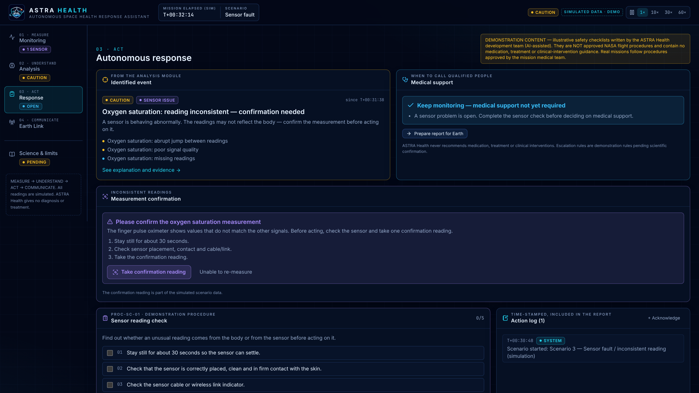<br/><sub>Cenário 3 — confirmação solicitada</sub></td>
    <td width="50%">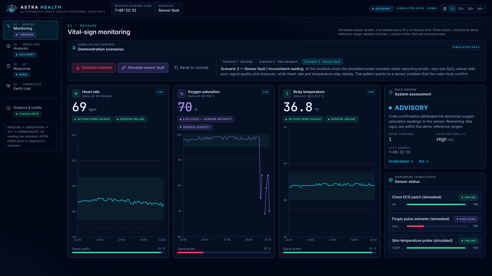<br/><sub>Cenário 3 — SpO₂ excluída como artefato de sensor</sub></td>
  </tr>
</table>

---

## 🎞 Sequência completa — Cenário 2 (alteração dos sinais vitais)

Dezesseis quadros 16:9 capturados com a simulação pausada em cada etapa, do estado normal até a resposta simulada da Terra
(atraso de 12 min por sentido). Pasta: [`docs/screenshots/sequence-vital-deviation/`](docs/screenshots/sequence-vital-deviation/).

<details>
<summary><b>Mostrar os 16 quadros</b></summary>
<br/>

<table>
  <tr>
    <td width="50%">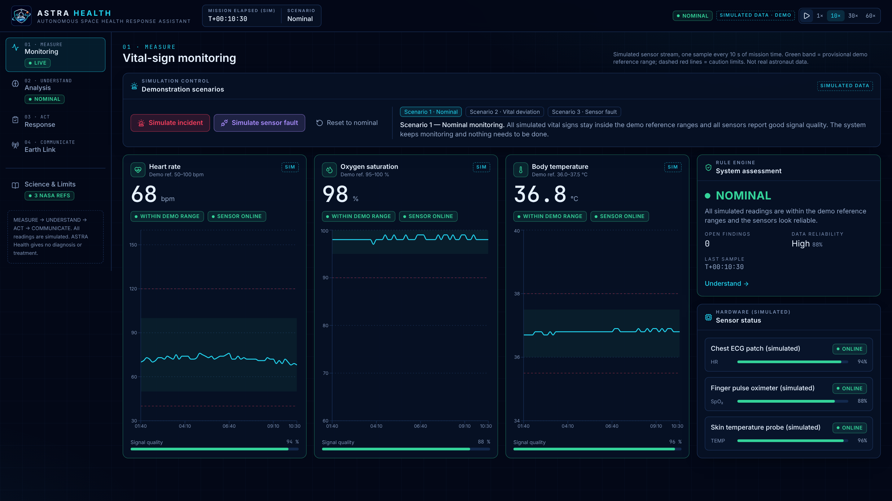<br/><sub><b>01 · MEDIR</b> — Estado normal</sub></td>
    <td width="50%"><br/><sub><b>02 · MEDIR</b> — Incidente simulado, valores ainda normais</sub></td>
  </tr>
  <tr>
    <td><br/><sub><b>03 · MEDIR</b> — Primeira alteração (SpO₂), CAUTION</sub></td>
    <td><br/><sub><b>04 · MEDIR</b> — Três sinais vitais fora da faixa, WARNING</sub></td>
  </tr>
  <tr>
    <td><br/><sub><b>05 · ENTENDER</b> — Achados e confiabilidade dos dados</sub></td>
    <td><br/><sub><b>06 · ENTENDER</b> — Histórico de eventos</sub></td>
  </tr>
  <tr>
    <td><br/><sub><b>07 · AGIR</b> — Evento identificado, solicitar suporte médico agora</sub></td>
    <td>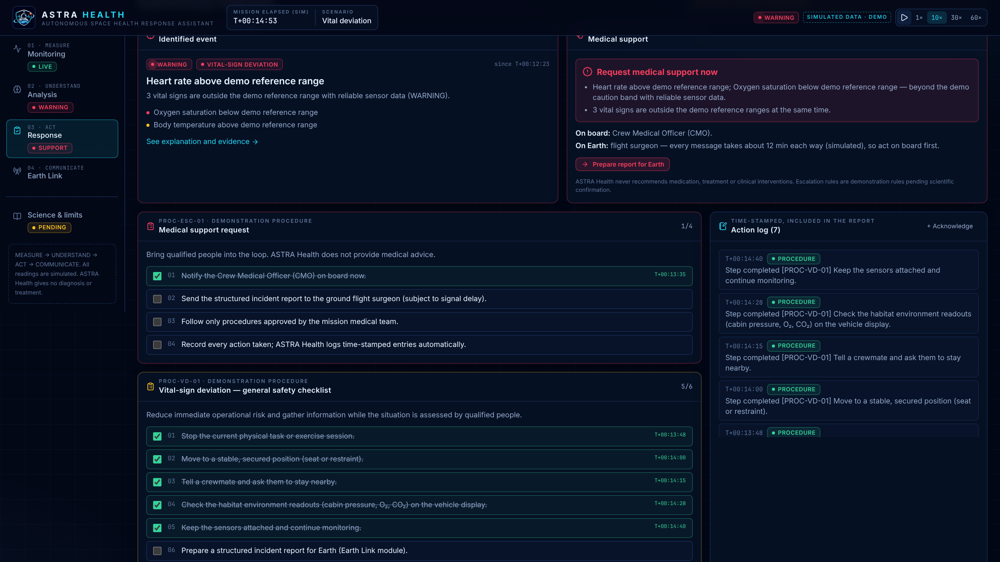<br/><sub><b>08 · AGIR</b> — Checklists e registro de ações</sub></td>
  </tr>
  <tr>
    <td>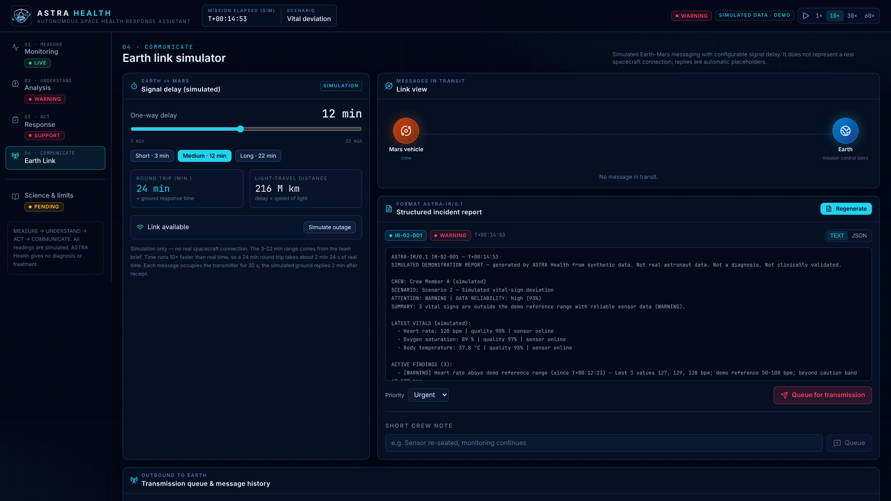<br/><sub><b>09 · COMUNICAR</b> — Relatório gerado (texto)</sub></td>
    <td>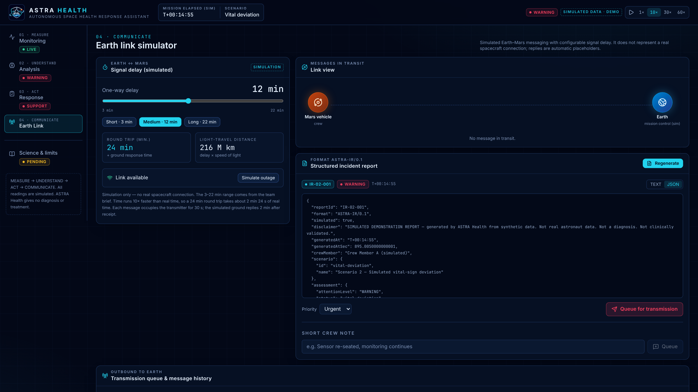<br/><sub><b>10 · COMUNICAR</b> — Relatório gerado (JSON)</sub></td>
  </tr>
  <tr>
    <td><br/><sub><b>11 · COMUNICAR</b> — Aguardando envio</sub></td>
    <td><br/><sub><b>12 · COMUNICAR</b> — Enviado, a caminho da Terra</sub></td>
  </tr>
  <tr>
    <td>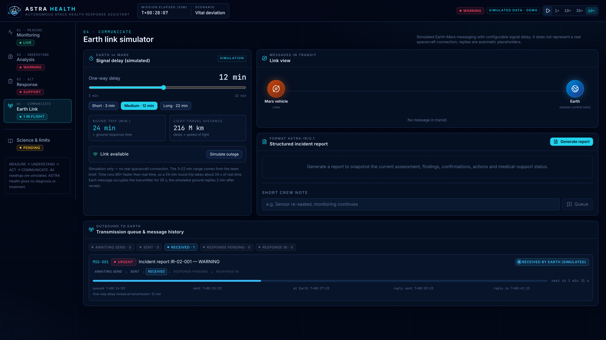<br/><sub><b>13 · COMUNICAR</b> — Recebido pela Terra (simulado)</sub></td>
    <td>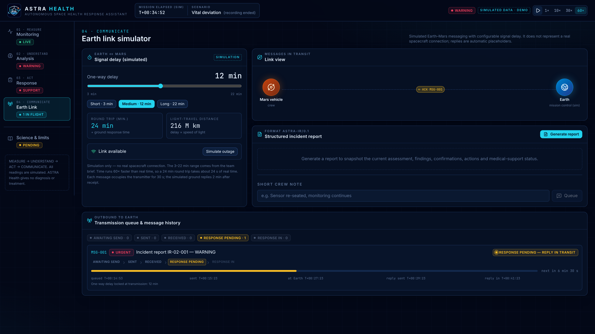<br/><sub><b>14 · COMUNICAR</b> — Resposta pendente, a caminho de Marte</sub></td>
  </tr>
  <tr>
    <td><br/><sub><b>15 · COMUNICAR</b> — Confirmação simulada recebida</sub></td>
    <td><br/><sub><b>16 · AGIR</b> — Checklists concluídos, registro completo</sub></td>
  </tr>
</table>

</details>

---

## 🧠 Motor de análise

Funções TypeScript puras e determinísticas (`src/lib/analysis`). A mesma entrada sempre produz a mesma saída; nenhum modelo
de IA roda dentro da aplicação.

### Regras

Cada sinal vital é avaliado sobre as últimas 24 amostras (4 min de missão).

| Regra | Disparo | Categoria | Nível |
|---|---|---|---|
| `VITAL_OUT_OF_RANGE` | 3 amostras válidas consecutivas fora da faixa demonstrativa, do mesmo lado; normaliza após 3 de volta à faixa (histerese) | 🔴 alteração de sinal vital | `CAUTION`; `WARNING` quando as 3 últimas passam da faixa de cautela |
| `SENSOR_DROPOUT` | Leituras ausentes nas últimas 10 amostras | 🟣 sensor | `ADVISORY` (1) · `CAUTION` (≥ 2) |
| `SENSOR_IMPLAUSIBLE` | Valor fora dos limites de plausibilidade física | 🟣 sensor | `CAUTION` · confirmação necessária |
| `SENSOR_ABRUPT_CHANGE` | Salto entre leituras consecutivas acima do passo máximo | 🟣 sensor | `ADVISORY` (1) · `CAUTION` (≥ 2) · confirmação necessária |
| `SENSOR_LOW_QUALITY` | Qualidade média de sinal das 3 últimas amostras < 60 % (ruim < 40 %) | 🟣 sensor | `ADVISORY` · `CAUTION` |
| `SENSOR_FLATLINE` | Frequência cardíaca exatamente igual por 12 amostras (2 min) | 🟣 sensor | `CAUTION` · confirmação necessária |
| `READING_INCONSISTENT` | Valor fora da faixa vindo de um sensor suspeito — substitui a alteração | 🟣 sensor | `CAUTION` · confirmação necessária |

### Níveis de atenção

| Nível | Significado na demonstração |
|---|---|
| 🟢 `NOMINAL` | Tudo dentro das faixas demonstrativas, sensores confiáveis. |
| 🔵 `ADVISORY` | Atenção (por exemplo, uma perda de leitura isolada ou um sensor excluído após confirmação). |
| 🟡 `CAUTION` | Verificar a situação e seguir o checklist. |
| 🔴 `WARNING` | Alteração confiável de sinal vital além da faixa de cautela — solicitar suporte médico. |

São categorias demonstrativas, **não níveis de triagem clínica**.

### Confiabilidade dos dados

- Por sinal vital: `qualidade do sinal × 100 − penalidades das regras` (perda de leitura −5 cada, salto brusco −10, valor implausível −20, valor congelado −20), `+3` quando duas ou mais alterações confiáveis se confirmam entre si.
- **Geral = o sinal vital mais fraco** — um único sensor pouco confiável já reduz a confiança no quadro todo.
- Rótulos: **High** ≥ 80 · **Medium** ≥ 55 · **Low** abaixo disso.
- A confiabilidade descreve a **qualidade dos dados**, não a certeza sobre a saúde do tripulante.

### Confirmação pelo astronauta

| Resultado | Efeito |
|---|---|
| **Artefato** — leitura de confirmação dentro da faixa demonstrativa | Os achados daquele sensor são resolvidos, o sensor é **excluído** e permanece um `ADVISORY`. |
| **Confirmada** — leitura também fora da faixa | A *leitura inconsistente* passa a ser uma alteração de sinal vital confirmada. |
| **Não foi possível medir novamente** | Os achados continuam abertos e o suporte médico é recomendado. |

### Quando solicitar suporte médico

| Urgência | Condição |
|---|---|
| **Solicitar agora** (`urgent`) | Qualquer alteração confiável de sinal vital em `WARNING`. |
| **Solicitar** (`recommended`) | ≥ 2 alterações simultâneas · alteração persistente por ≥ 3 min · alteração confirmada · leitura inconsistente que não pôde ser verificada. |
| **Continuar monitorando** (`monitor`) | Uma única alteração em `CAUTION`, ou um problema de sensor em aberto (verificar o sensor primeiro). |
| **Não necessário** (`none`) | Situação normal, ou a leitura anormal foi atribuída ao sensor. |

O ASTRA Health indica apenas **quando** envolver o Oficial Médico da Tripulação e o médico de voo. Ele nunca indica **qual tratamento** aplicar.

---

## 📡 Simulador de comunicação Terra–Marte

```mermaid
stateDiagram-v2
    direction LR
    [*] --> AguardandoEnvio: relatório na fila
    AguardandoEnvio --> Enviado: transmissor livre e link ativo (30 s)
    Enviado --> Recebido: atraso de um sentido (3–22 min)
    Recebido --> RespostaPendente: atendimento em solo (2 min)
    RespostaPendente --> RespostaRecebida: atraso de um sentido
    RespostaRecebida --> [*]
```

- Um transmissor, **30 s** por mensagem; ordem: **urgente → prioritária → rotina** e, depois, ordem de chegada.
- Mensagens aguardam enquanto o link está **indisponível** (simulação de queda) e saem assim que ele é restabelecido.
- O atraso de um sentido é **fixado** no momento da transmissão; mudar o controle afeta apenas as novas mensagens.
- A estação terrestre simulada responde **2 min** após o recebimento com uma confirmação automática que deixa claro que **nenhuma pessoa real revisou o conteúdo**.
- Ida e volta exibida na interface = `2 × atraso de um sentido` (+ tempo de resposta em solo). Distância percorrida pela luz = `atraso × velocidade da luz`.

**Exemplo da sequência completa (atraso de 12 min por sentido):**

| Evento | Horário da missão |
|---|---|
| Relatório colocado na fila | T+00:14:53 |
| Transmissão concluída — **enviado** | T+00:15:23 |
| **Recebido** pela Terra | T+00:27:23 |
| Resposta enviada pela Terra — **resposta pendente** | T+00:29:23 |
| **Resposta recebida** a bordo | T+00:41:23 |

---

## 🧾 Relatório de incidente (ASTRA-IR/0.1)

Gerado a partir do estado atual na página Earth Link e anexado à mensagem enviada. Trecho de um relatório real produzido pelo
código no Cenário 2 (todos os valores simulados; o conteúdo do relatório é gerado em inglês, como a interface):

```json
{
  "reportId": "IR-02-001",
  "format": "ASTRA-IR/0.1",
  "simulated": true,
  "disclaimer": "SIMULATED DEMONSTRATION REPORT — generated by ASTRA Health from synthetic data. Not real astronaut data. Not a diagnosis. Not clinically validated.",
  "generatedAt": "T+00:15:20",
  "crewMember": "Crew Member A (simulated)",
  "assessment": {
    "attentionLevel": "WARNING",
    "status": "vital-deviation",
    "summary": "3 vital signs are outside the demo reference range with reliable sensor data (WARNING).",
    "dataReliability": { "score": 96, "label": "High" }
  },
  "latestVitals": [
    { "vital": "hr", "value": "129", "unit": "bpm", "signalQuality": 0.93, "sensorStatus": "online" },
    { "vital": "spo2", "value": "89", "unit": "%", "signalQuality": 0.93, "sensorStatus": "online" },
    { "vital": "temp", "value": "37.8", "unit": "°C", "signalQuality": 0.97, "sensorStatus": "online" }
  ],
  "activeFindings": [
    {
      "title": "Heart rate above demo reference range",
      "level": "WARNING",
      "evidence": "Last 3 values 129, 129, 129 bpm; demo reference 50–100 bpm; beyond caution band 40–120 bpm.",
      "since": "T+00:11:50"
    }
  ],
  "actionsTaken": [
    { "at": "T+00:15:00", "text": "Step completed [PROC-ESC-01] Notify the Crew Medical Officer (CMO) on board now." }
  ],
  "medicalSupport": { "urgency": "urgent", "headline": "Request medical support now" },
  "requestToGround": "PRIORITY: Request flight surgeon review of the attached simulated data and guidance through approved procedures.",
  "scientificBasis": {
    "referenceRanges": "PROVISIONAL: Demonstration placeholder values chosen by the development team. Not clinically validated. …",
    "nasaResource": "Pending team confirmation — no NASA resource integrated yet."
  }
}
```

O relatório completo também traz todos os achados, os achados resolvidos, as confirmações, todas as ações registradas e os
motivos da decisão sobre suporte médico. Uma versão em texto simples é transmitida como corpo da mensagem.

---

## 🏗 Arquitetura

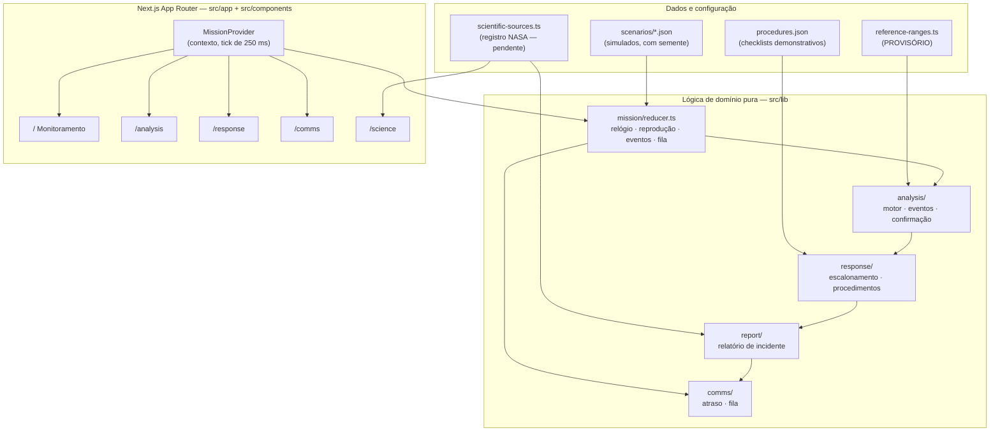

**Princípios de projeto**

- **Núcleo puro, interface fina** — toda a lógica de domínio é pura e tipada; os componentes React só exibem o estado derivado e disparam ações, então o ciclo completo é testável sem navegador.
- **Um único relógio simulado** — horários consistentes entre monitoramento, análise, ações e mensagens.
- **Configuração em vez de código** — limites, registro da NASA, cenários e procedimentos são dados, substituíveis sem mexer nos motores.
- **Honestidade garantida por testes** — os testes falham se um recurso da NASA for declarado sem procedência completa, ou se os procedimentos mencionarem medicamentos ou intervenções clínicas.

<details>
<summary><b>Estrutura do projeto</b></summary>

```text
astrahealth/
├── src/
│   ├── app/                      # Rotas: / · /analysis · /response · /comms · /science
│   │   ├── layout.tsx            # MissionProvider + AppShell
│   │   ├── icon.png · apple-icon.png · opengraph-image.png
│   │   └── globals.css           # Tokens do tema (azul-marinho / ciano, cores de alerta)
│   ├── components/
│   │   ├── layout/               # Cabeçalho, navegação lateral, logo
│   │   ├── ui/                   # Panel, Badge, Button, ProgressBar, mapas de cor
│   │   └── monitor/ · analysis/ · response/ · comms/ · science/
│   ├── state/MissionProvider.tsx # Contexto React + relógio da simulação
│   ├── lib/
│   │   ├── mission/reducer.ts    # Máquina de estados pura
│   │   ├── analysis/             # Motor de regras, eventos, confirmação
│   │   ├── response/             # Escalonamento + seleção de procedimentos
│   │   ├── comms/                # Cálculo de atraso + fila de transmissão
│   │   ├── report/               # Relatório de incidente ASTRA-IR/0.1
│   │   └── scenarios.ts · time.ts · types.ts
│   ├── config/
│   │   ├── reference-ranges.ts   # Limites PROVISÓRIOS
│   │   └── scientific-sources.ts # Registro do recurso da NASA
│   ├── data/
│   │   ├── scenarios/*.json      # Gravações simuladas (180 amostras × 10 s)
│   │   └── procedures.json       # Checklists demonstrativos
│   └── assets/astra-emblem.png
├── tests/                        # Vitest: motor, comunicação, cenários, salvaguardas, interface
├── scripts/                      # Gerador de dados, capturas, sequência, banners
├── docs/                         # Arquitetura, limitações, guia NASA, roteiro, imagens
├── public/brand/astra-health-logo.png
├── AI_DISCLOSURE.md
└── README.md · README.pt-BR.md
```

</details>

Mais detalhes: [docs/ARCHITECTURE.md](docs/ARCHITECTURE.md) (em inglês).

---

## 🛠 Tecnologias

| Camada | Tecnologia |
|---|---|
| Framework | [Next.js 16](https://nextjs.org) (App Router, Cache Components, Turbopack) · React 19 |
| Linguagem | TypeScript (modo strict) |
| Estilo | Tailwind CSS 4 — tema escuro azul-marinho e ciano, cores de alerta distintas |
| Gráficos | Recharts 3 |
| Ícones | Lucide |
| Testes | Vitest 5 · Testing Library · jsdom |
| Ferramentas | ESLint (Next.js core-web-vitals + TypeScript) · Playwright (somente capturas e banners) |
| Hospedagem | Vercel |

Sem autenticação, sem banco de dados, sem APIs externas e sem variáveis de ambiente. Os dados simulados ficam em JSON.

---

## 🚀 Como executar

**Requisitos:** Node.js **≥ 20.9** e npm.

```bash
git clone https://github.com/recpires/astrahealth.git
cd astrahealth
npm install
npm run dev
# abra http://localhost:3000
```

**Primeiros passos no aplicativo**

1. Observe o cenário 1 (normal) em **Monitoring**.
2. Clique em **Simulate incident** (cenário 2) ou **Simulate sensor fault** (cenário 3).
3. Siga a navegação lateral: **Analysis → Response → Earth Link**.
4. Use os controles do cabeçalho para pausar ou mudar a velocidade; **Reset to nominal** recomeça.

### Scripts npm

| Comando | Descrição |
|---|---|
| `npm run dev` | Servidor de desenvolvimento em http://localhost:3000 |
| `npm run build` / `npm run start` | Build de produção / servidor de produção |
| `npm test` | Executa todos os testes automatizados uma vez |
| `npm run test:watch` | Testes em modo observação |
| `npm run lint` | ESLint |
| `npm run typecheck` | Gera os tipos das rotas e executa `tsc --noEmit` |
| `npm run generate:data` | Regenera os cenários simulados (com semente, reproduzível) |
| `npm run screenshots` | 12 capturas para apresentação → `docs/screenshots/` ¹ |
| `npm run screenshots:sequence` | Sequência de 16 quadros do Cenário 2 → `docs/screenshots/sequence-vital-deviation/` ¹ |
| `npm run banners` | Banners do README (EN / PT) → `docs/assets/` ² |

¹ Requer o servidor em execução (`BASE_URL`, padrão `http://localhost:3000`) e o Playwright com Chromium.
² Requer o Playwright com Chromium.

---

## 🧪 Testes

```bash
npm test
```

**52 testes em 5 arquivos**, todos determinísticos:

| Arquivo | O que cobre |
|---|---|
| `tests/scenarios.test.ts` | Fluxo completo MEDIR → ENTENDER → AGIR → COMUNICAR de cada cenário no reducer da missão: detecções, escalonamento, procedimentos, confirmação, relatório e todos os estados da mensagem. |
| `tests/analysis.test.ts` | Cada regra (persistência/histerese, perda de leitura, plausibilidade, taxa de variação, qualidade, valor congelado, verificação cruzada), confiabilidade, eventos, resultados da confirmação e ausência de termos diagnósticos. |
| `tests/comms.test.ts` | Limites do atraso, ida e volta, distância percorrida pela luz, fila por ordem de chegada e por prioridade, queda do link, fixação do atraso e linha do tempo dos estados. |
| `tests/science.test.ts` | Salvaguardas: nenhum recurso da NASA declarado enquanto pendente; rótulos de provisório; procedimentos sem termos de medicamento ou intervenção clínica. |
| `tests/ui/modules.test.tsx` | Os quatro módulos renderizados com Testing Library: botões de incidente, achados, confirmação, registro de checklist, atalhos de atraso, geração e envio do relatório, valores não verificados de sensor suspeito. |

Verificações executadas antes de cada commit: `npm test`, `npm run lint`, `npm run typecheck`, `npm run build`.

---

## 🖼 Capturas de tela e banners

Todas as imagens são capturadas da aplicação em execução (não são montagens) em quadros **16:9**, prontos para slides:

- [`docs/screenshots/`](docs/screenshots/) — 12 capturas cobrindo os três cenários e a página de ciência (2880 × 1620 px).
- [`docs/screenshots/sequence-vital-deviation/`](docs/screenshots/sequence-vital-deviation/) — a sequência de 16 quadros acima, com legendas.
- [`docs/assets/`](docs/assets/) — banners do README em inglês e português, gerados a partir de `scripts/banner/banner.html`.

---

## ☁ Publicação (Vercel)

A aplicação pré-renderiza todas as rotas como conteúdo estático e **não precisa de variáveis de ambiente**.

[](https://vercel.com/new/clone?repository-url=https%3A%2F%2Fgithub.com%2Frecpires%2Fastrahealth)

1. Envie o repositório para o GitHub.
2. Na Vercel: **Add New… → Project → Import** do repositório.
3. Mantenha o preset **Next.js** detectado (build `next build`, Node.js 20+).
4. **Deploy.**

Pela linha de comando: `npx vercel` (prévia) e `npx vercel --prod` (produção).

---

## 🔬 Base científica e limitações

### Recurso científico da NASA — *aguardando confirmação da equipe*

A arquitetura está pronta para integrar **um recurso científico real da NASA**, mas nenhum foi integrado ainda e nenhum é
declarado no aplicativo, nos relatórios ou nesta documentação. O registro em `src/config/scientific-sources.ts` permanece
vazio até que a Equipe ANGARIS confirme o enunciado oficial do desafio. Depois da confirmação, ele deve registrar **nome,
origem, URL/DOI, versão, data de acesso e utilização efetiva** do recurso — um teste garante isso. Guia passo a passo:
[docs/NASA_RESOURCE.md](docs/NASA_RESOURCE.md) (em inglês).

### Limites demonstrativos provisórios

De `src/config/reference-ranges.ts` (status **PROVISIONAL** — valores provisórios escolhidos pela equipe de desenvolvimento,
sem validação clínica e sem origem em fonte da NASA):

| Sinal vital | Referência demonstrativa | Faixa de cautela | Limites de plausibilidade | Passo máximo / 10 s |
|---|---|---|---|---|
| Frequência cardíaca | 50–100 bpm | 40–120 bpm | 25–230 bpm | 30 bpm |
| SpO₂ | 95–100 % | 90–100 % | 50–100 % | 6 % |
| Temperatura corporal | 36,0–37,5 °C | 35,5–38,0 °C | 30–43 °C | 0,6 °C |

### Principais limitações

- Todos os dados são **sintéticos**, produzidos por um gerador com semente (`scripts/generate-scenarios.mjs`); não vêm de nenhuma pessoa, missão ou conjunto de dados da NASA.
- Regras, níveis, índices de confiabilidade e critérios de escalonamento são **escolhas demonstrativas**, sem validação clínica.
- Os procedimentos são checklists de segurança **ilustrativos**, não procedimentos de voo aprovados, e nunca incluem medicamentos ou tratamentos.
- A faixa de atraso Terra–Marte (3–22 min) vem do briefing da equipe; o atraso real depende da posição dos planetas, e o link pode ficar indisponível por longos períodos. As respostas da Terra são confirmações automáticas.
- Apenas três cenários são modelados; fisiologia e artefatos de sensor reais são muito mais variados.
- Sem autenticação, persistência, criptografia ou processos de qualidade de dispositivo médico. O estado é reiniciado ao recarregar a página.

Lista completa: [docs/SCIENTIFIC_LIMITATIONS.md](docs/SCIENTIFIC_LIMITATIONS.md) (em inglês).

---

## 🗺 Roadmap

Próximos passos possíveis (não são compromissos):

- [ ] Confirmar o enunciado do desafio e registrar o recurso da NASA; derivar dele os limites.
- [ ] Revisão por especialistas das regras, do escalonamento e do texto dos checklists.
- [ ] Interface de adaptadores para sensores vestíveis reais (substituindo a reprodução dos JSON).
- [ ] Registro de incidentes e relatórios persistentes e exportáveis.
- [ ] Atraso Terra–Marte baseado em efemérides e janelas de bloqueio por conjunção solar; modelo de largura de banda.
- [ ] Visão para múltiplos tripulantes e console do Oficial Médico da Tripulação.
- [ ] Interface totalmente bilíngue (EN / PT-BR) e auditoria de acessibilidade.

---

## 🤖 Declaração de uso de ferramentas de IA

> *AI Tools & Usage Disclosure* — versão original em inglês no [README.md](README.md#-ai-tools--usage-disclosure).

A Equipe ANGARIS utilizou ferramentas assistidas por IA, incluindo Claude Code, Codex e ChatGPT, conforme aplicável, para apoiar o desenvolvimento de software, a revisão de código, a documentação e a preparação da apresentação.

O conceito do projeto, as decisões técnicas, os testes e a validação final são de responsabilidade da Equipe ANGARIS.

Todos os dados fisiológicos apresentados no protótipo são simulados. O ASTRA Health é uma demonstração experimental e não é um dispositivo médico clinicamente validado.

Observações adicionais:

- **Logo** — a logo do ASTRA Health é uma imagem gerada por IA. O arquivo original mantém a identificação *AI-generated* (`public/brand/astra-health-logo.png`) e aparece com ela nos banners; o emblema do cabeçalho, o ícone da aba e a imagem de compartilhamento são recortes dela.
- **Dentro do aplicativo** — nenhum modelo de IA roda na aplicação; toda a análise é determinística e baseada em regras.

Detalhes: [AI_DISCLOSURE.md](AI_DISCLOSURE.md) (em inglês).

---

## 👥 Equipe

**Equipe ANGARIS** — NASA Space Apps Challenge 2026.

<!-- Adicione aqui os integrantes, por exemplo:
| Nome | Papel | GitHub |
|---|---|---|
| … | … | … |
-->

## 📄 Licença

Nenhuma licença foi escolhida ainda. Até que uma seja adicionada, todos os direitos são reservados aos autores.

## 🙏 Agradecimentos

- Aos organizadores e à comunidade do **NASA Space Apps Challenge**.
- Aos projetos de código aberto que tornam este protótipo possível: Next.js, React, Tailwind CSS, Recharts, Lucide, Vitest, Testing Library e Playwright.

<sub>O ASTRA Health é um projeto de hackathon. Não é afiliado à NASA nem endossado por ela. Todos os dados de sinais vitais são simulados.</sub>
