# ASTRA Health — Relatório de testes dos três cenários de demonstração

[English](TEST_REPORT.md)

> Gerado por `scripts/build-test-report.mjs` a partir de resultados legíveis por máquina. Não edite à mão — execute novamente os comandos abaixo.

## Resumo

| | |
|---|---|
| Resultado geral | ✅ **APROVADO** |
| Casos de aceitação (plano de testes) | 17/17 |
| Verificações no navegador (ponta a ponta) | 14/14 |
| Suíte automatizada completa (Vitest) | 77/77 (8 files) |
| Erros de página no navegador | 0 |
| Data da execução | 2026-11-15 03:08 UTC |
| Versão do código (commit) | `a2d673bb30` |
| Árvore de trabalho | limpa (nenhuma alteração de código não commitada) |

### Resultados por cenário

| Cenário | Casos de aceitação (plano de testes) | Verificações no navegador (ponta a ponta) | Resultado |
|---|---|---|---|
| [Cenário 1 — Monitoramento normal](#s1) | 4/4 | 4/4 | ✅ |
| [Cenário 2 — Alteração simulada dos sinais vitais](#s2) | 7/7 | 4/4 | ✅ |
| [Cenário 3 — Falha de sensor / leitura inconsistente](#s3) | 6/6 | 6/6 | ✅ |

## Como reproduzir

Requisitos: Node.js ≥ 20.9; as verificações no navegador também precisam do Playwright com Chromium.

```bash
npm ci
npm run test:evidence   # Vitest: full suite + acceptance evidence (JSON)
npm run build
npm run test:e2e        # Playwright: browser checks against the production build + screenshots
npm run test:report     # regenerates this report
```

## Ambiente

| | |
|---|---|
| Node.js | v22.23.4 |
| OS | linux x64 |
| Next.js | 16.4.6 |
| Vitest | 5.1.0 |
| Browser | Chromium 153.0.8010.12 · 1440×810 · next start (production build) |

## O que estes resultados mostram — e o que não mostram

- Mostram que o protótipo se comporta como especificado no plano de testes nos três cenários roteirizados: medição, análise, orientação de resposta e comunicação com atraso com a Terra, de ponta a ponta.
- Todos os sinais vitais são **simulados** (com semente, reproduzíveis). Nenhum dado real de astronauta é usado.
- Limites, regras, escalonamento e checklists são **escolhas demonstrativas provisórias**; passar nestes testes **não** os valida clinicamente, e a fonte dos limites de análise ainda aguarda confirmação da equipe.
- Os horários de missão são determinísticos (relógio simulado). Durações em tempo real nas verificações do navegador dependem da máquina e são apenas indicativas.

_Os valores observados aparecem como produzidos pela aplicação (interface em inglês)._

<a id="s1"></a>

## Cenário 1 — Monitoramento normal

| ID | Etapa | Esperado | Observado | Resultado |
|---|---|---|---|---|
| **S1-01** | MEDIR | Todas as amostras dentro das faixas demonstrativas em 400 amostras (incluindo a emenda da repetição); todos os sensores online; cenário marcado como simulado | 400 samples: 0 outside the demo ranges (HR 66–76 bpm, SpO₂ 97–99 %, temperature 36.6–36.9 °C); 0 sensor readings not online | ✅ |
| **S1-02** | ENTENDER | Nível NOMINAL em todas as amostras; nenhum achado; apenas o evento de início; confiabilidade dos dados High | 0/400 samples not NOMINAL; 0 findings; 0 non-system events; lowest reliability 87 % | ✅ |
| **S1-03** | AGIR | Suporte médico não necessário; apenas o procedimento de monitoramento de rotina (PROC-NM-01) | Medical support not required by the demo rules; procedures: PROC-NM-01 | ✅ |
| **S1-04** | COMUNICAR | Relatório de rotina: na fila → enviado (+30 s) → recebido (+12 min 30 s) → resposta pendente (+14 min 30 s) → resposta recebida (+26 min 30 s) com atraso de 12 min por sentido | queued +0 s → sent +30 s → received +12 min 30 s → response-pending +14 min 30 s → response-received +26 min 30 s | ✅ |

<details>
<summary>Detalhes observados (registrados pelo teste de aceitação)</summary>

**S1-01** — Frequência cardíaca, SpO₂ e temperatura; estado dos sensores; indicadores de normalidade; dados identificados como demonstração

- **samplesChecked**: 400
- **observedRanges**: heartRate = 66–76 bpm · spo2 = 97–99 % · temperature = 36.6–36.9 °C
- **samplesOutOfDemoRange**: 0
- **sensorReadingsNotOnline**: 0
- **scenarioFlaggedSimulated**: true

**S1-02** — Regras determinísticas; nível de atenção e confiabilidade; histórico de eventos

- **samplesChecked**: 400
- **samplesNotNominal**: 0
- **findingsAtEnd**: 0
- **events**:
  - system: Scenario 1 — Nominal monitoring started
- **lowestReliabilityScore**: 87
- **reliabilityLabel**: High

**S1-03** — Procedimentos predefinidos; indicar quando é necessário suporte médico

- **medicalSupport**: none — Medical support not required by the demo rules
- **procedures**:
  - PROC-NM-01 Routine monitoring

**S1-04** — Atraso de 3–22 min; estimativa de ida e volta; relatório estruturado; fila; estados aguardando envio, enviado, recebido, resposta pendente

- **oneWayDelay**: 12 min
- **roundTripShownInUi**: 24 min
- **reportId**: IR-02-001
- **reportRequest**: For information: routine status. No action requested.
- **statesObserved**: queued = +0 s · sent = +30 s · received = +12 min 30 s · response-pending = +14 min 30 s · response-received = +26 min 30 s
- **timeline**: sent = +30 s · received = +12 min 30 s · responsePending = +14 min 30 s · responseReceived = +26 min 30 s

</details>

| ID | Cobre | Esperado | Observado no navegador | Resultado | Evidência |
|---|---|---|---|---|---|
| **E2E-S1-01** | S1-01, S1-02 | NOMINAL; 3 × 'Within demo range'; 3 × 'Sensor Online'; 'Simulated data' label | level NOMINAL; 3/3 within demo range; 3/3 sensors online; simulated label shown | ✅ | [PNG](test-results/e2e/E2E-S1-01.png) |
| **E2E-S1-02** | S1-02 | NOMINAL; 'Findings (0)'; reliability High | level NOMINAL; 0 findings; reliability High | ✅ | — |
| **E2E-S1-03** | S1-03 | 'Medical support not required by the demo rules'; PROC-NM-01 | "Medical support not required by the demo rules"; procedure PROC-NM-01 shown | ✅ | [PNG](test-results/e2e/E2E-S1-03.png) |
| **E2E-S1-04** | S1-04 | priority routine; queued → sent → received → response pending → response received | MSG-001 (routine): queued → sent → received → response-pending → response-received | ✅ | [PNG](test-results/e2e/E2E-S1-04.png) |

<details>
<summary>Capturas de tela (evidência)</summary>

**E2E-S1-01** — Monitoring shows three simulated vital signs within range, sensors online, level NOMINAL

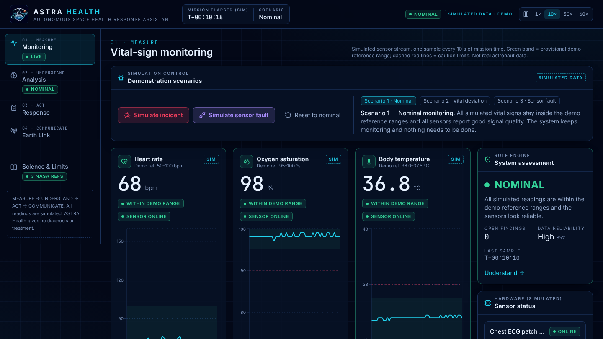

**E2E-S1-03** — Response shows no medical support and routine monitoring only

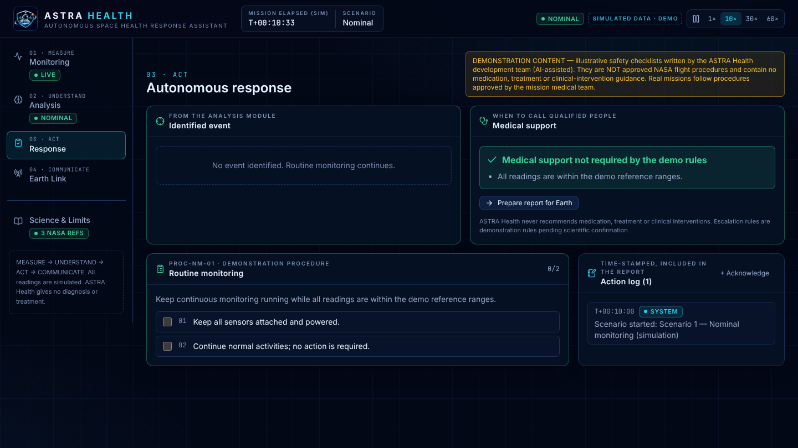

**E2E-S1-04** — Routine report is queued and passes through every message state

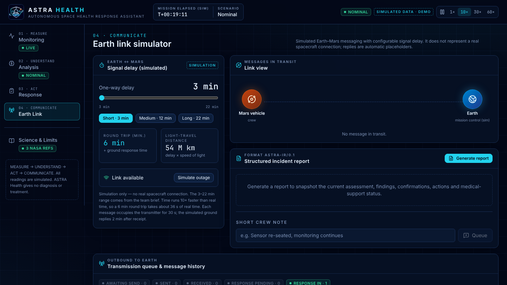

</details>

<a id="s2"></a>

## Cenário 2 — Alteração simulada dos sinais vitais

| ID | Etapa | Esperado | Observado | Resultado |
|---|---|---|---|---|
| **S2-01** | MEDIR | Frequência cardíaca sobe, SpO₂ cai e temperatura sobe após o início, com os três sensores online | HR 67 → 130 bpm, SpO₂ 98 → 88 %, temperature 36.8 → 37.8 °C; sensors online / online / online | ✅ |
| **S2-02** | ENTENDER | Nenhuma detecção antes do início; alterações de SpO₂, frequência cardíaca e temperatura detectadas; frequência cardíaca e SpO₂ escalam para WARNING; eventos em ordem cronológica | onset +20 s; first detection 1 min 10 s after onset; 3 detections; escalated to WARNING: Oxygen saturation below; Heart rate above | ✅ |
| **S2-03** | ENTENDER | Nível final WARNING, status alteração de sinal vital, confiabilidade High (sinais concordantes); explicações dizem 'not a diagnosis' e não usam termos diagnósticos | WARNING · vital-deviation · reliability High (94 %) · 0 diagnostic terms | ✅ |
| **S2-04** | AGIR | 'Request medical support now' (urgente); procedimentos PROC-ESC-01 e PROC-VD-01; nenhum medicamento ou tratamento em nenhum procedimento | Request medical support now; PROC-ESC-01 + PROC-VD-01; 0 treatment terms in procedures | ✅ |
| **S2-05** | AGIR | Cada passo concluído do checklist é registrado com o horário da missão | 2 steps logged at +30 min and +30 min 20 s | ✅ |
| **S2-06** | COMUNICAR | Relatório marcado como simulado, atenção WARNING, 3 achados ativos, urgência urgent, pedido PRIORITY, ações registradas incluídas | IR-02-001: simulated=true, WARNING, 3 findings, urgency urgent, request "PRIORITY", 2 actions | ✅ |
| **S2-07** | COMUNICAR | Com o link fora do ar, as duas mensagens aguardam; ao restabelecer, o relatório urgente é transmitido antes da nota de rotina anterior; o relatório urgente passa por todos os estados | link down: queued + queued; transmitted first: urgent report; urgent report: queued +0 s → sent +1 min 30 s → received +6 min 30 s → response-pending +8 min 30 s → response-received +13 min 30 s | ✅ |

<details>
<summary>Detalhes observados (registrados pelo teste de aceitação)</summary>

**S2-01** — Gráficos e indicadores de normalidade dos sinais vitais

- **beforeOnset**: heartRate = 67 · spo2 = 98 · temperature = 36.8
- **endOfRecording**: heartRate = 130 · spo2 = 88 · temperature = 37.8
- **sensorStatusAtEnd**: heartRate = online · spo2 = online · temperature = online
- **playbackComplete**: true

**S2-02** — Detectar alterações por regras determinísticas; histórico de eventos

- **incidentOnset**: +20 s
- **eventTimeline**:
  - +1 min 30 s detected CAUTION — Oxygen saturation below demo reference range
  - +1 min 50 s detected CAUTION — Heart rate above demo reference range
  - +2 min detected CAUTION — Body temperature above demo reference range
  - +2 min 20 s escalated WARNING — Oxygen saturation below demo reference range
  - +2 min 30 s escalated WARNING — Heart rate above demo reference range
- **firstDetectionAfterOnset**: +1 min 10 s
- **detections**: 3
- **escalationsToWarning**:
  - Oxygen saturation below demo reference range
  - Heart rate above demo reference range

**S2-03** — Explicação em linguagem simples; nível de atenção e confiabilidade; sem diagnóstico

- **attentionLevel**: WARNING
- **status**: vital-deviation
- **reliability**: High (94 %)
- **findings**:
  - WARNING Heart rate above demo reference range
  - WARNING Oxygen saturation below demo reference range
  - CAUTION Body temperature above demo reference range
- **diagnosticTermsFound**:

**S2-04** — Exibir o evento identificado; procedimentos de segurança predefinidos; indicar suporte médico

- **identifiedEvent**: Heart rate above demo reference range
- **medicalSupport**: urgent — Request medical support now
- **reasons**:
  - Heart rate above demo reference range; Oxygen saturation below demo reference range — beyond the demo caution band with reliable sensor data.
  - 3 vital signs are outside the demo reference ranges at the same time.
  - A deviation has persisted for 19 min or more.
- **procedures**:
  - PROC-ESC-01 Medical support request
  - PROC-VD-01 Vital-sign deviation — general safety checklist
- **treatmentTermsFound**:

**S2-05** — Registrar as ações realizadas

- **actionLog**:
  - +30 min Step completed [PROC-ESC-01] Notify the Crew Medical Officer (CMO) on board now.
  - +30 min 20 s Step completed [PROC-VD-01] Stop the current physical task or exercise session.

**S2-06** — Relatório estruturado do incidente

- **reportId**: IR-02-001
- **format**: ASTRA-IR/0.1
- **simulated**: true
- **attentionLevel**: WARNING
- **activeFindings**: 3
- **medicalSupport**: urgent
- **requestToGround**: PRIORITY: Request flight surgeon review of the attached simulated data and guidance through approved procedures.
- **actionsIncluded**: 2
- **disclaimer**: SIMULATED DEMONSTRATION REPORT — generated by ASTRA Health from synthetic data. Not real astronaut data. Not a diagnosis. Not clinically validated.

**S2-07** — Fila de transmissão; estados das mensagens; histórico

- **oneWayDelay**: 5 min
- **statesWhileLinkDown**:
  - queued
  - queued
- **transmissionOrder**:
  - MSG-002 (urgent)
  - MSG-001 (routine)
- **urgentReportStatesObserved**: queued = +0 s · sent = +1 min 30 s · received = +6 min 30 s · response-pending = +8 min 30 s · response-received = +13 min 30 s

</details>

| ID | Cobre | Esperado | Observado no navegador | Resultado | Evidência |
|---|---|---|---|---|---|
| **E2E-S2-01** | S2-01, S2-02 | WARNING within 60 s of real time at 10×; HR 'Above demo range'; SpO₂ 'Below demo range'; sensors online | WARNING after 14.0 s real time (10×); HR 127 bpm (above demo range 50–100); SpO₂ 88 % (below demo range 95–100); 3/3 sensors online | ✅ | [PNG](test-results/e2e/E2E-S2-01.png) |
| **E2E-S2-02** | S2-02, S2-03 | 3 VITAL_OUT_OF_RANGE findings; 'not a diagnosis'; reliability High; 'escalated' events | level WARNING; 3 vital-sign findings; reliability High; 2 escalation events; 'not a diagnosis' shown 4× | ✅ | [PNG](test-results/e2e/E2E-S2-02.png) |
| **E2E-S2-03** | S2-04, S2-05 | 'Request medical support now'; PROC-ESC-01 + PROC-VD-01; step logged in the action log | "Request medical support now"; PROC-ESC-01 + PROC-VD-01 shown; log: "Step completed [PROC-ESC-01] Notify the Crew Medical Officer (CMO) on board now" | ✅ | [PNG](test-results/e2e/E2E-S2-03.png) |
| **E2E-S2-04** | S2-06, S2-07 | report shows WARNING + disclaimer; priority urgent; every message state reached | MSG-002 (urgent); report: WARNING + simulation disclaimer; queued → sent → received → response-pending → response-received | ✅ | [PNG](test-results/e2e/E2E-S2-04.png) |

<details>
<summary>Capturas de tela (evidência)</summary>

**E2E-S2-01** — 'Simulate incident' leads to WARNING with HR above and SpO₂ below the demo range

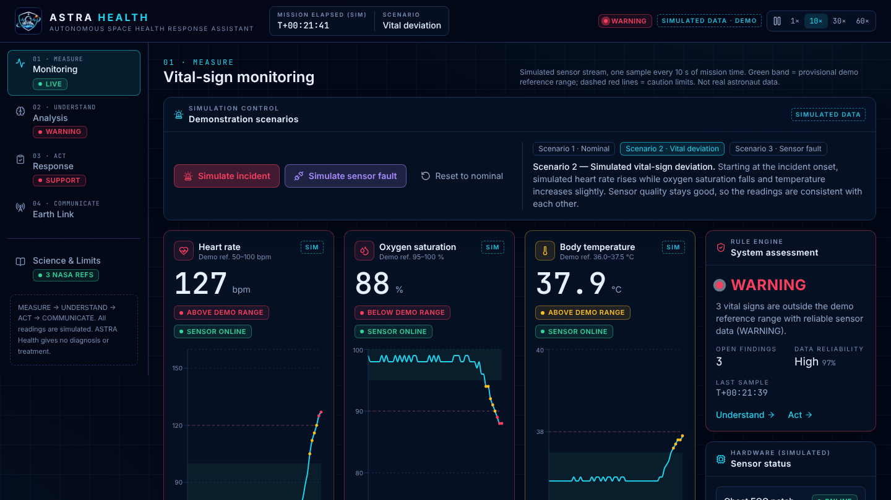

**E2E-S2-02** — Analysis lists three vital-sign deviations, reliability High and escalation events

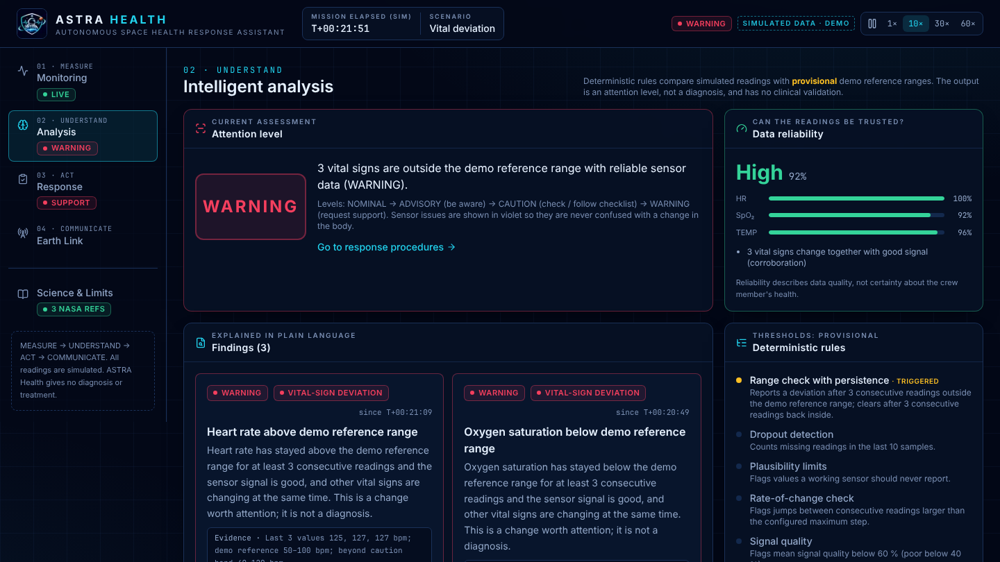

**E2E-S2-03** — Response requests medical support now and logs a completed checklist step

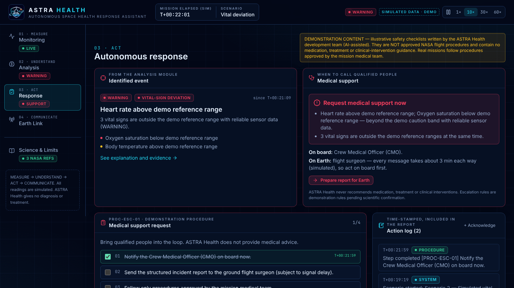

**E2E-S2-04** — Urgent incident report is generated and delivered through every state

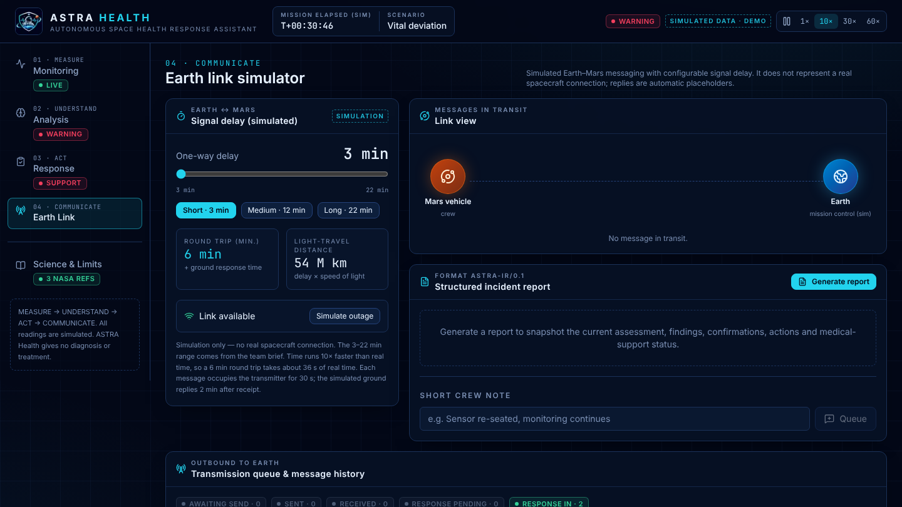

</details>

<a id="s3"></a>

## Cenário 3 — Falha de sensor / leitura inconsistente

| ID | Etapa | Esperado | Observado | Resultado |
|---|---|---|---|---|
| **S3-01** | MEDIR | Sensor de SpO₂ com qualidade de sinal ruim e perdas de leitura (não online), enquanto os sensores de frequência cardíaca e temperatura continuam online | SpO₂ sensor suspect, 24 dropouts, quality ≤ 35 %; heart rate online, temperature online | ✅ |
| **S3-02** | ENTENDER | Achados de sensor (salto brusco, baixa qualidade, perda de leitura, leitura inconsistente); nenhuma alteração de sinal vital; nível CAUTION; confiabilidade Low | first detection 0 s after onset; 4 sensor findings, 0 vital deviations; CAUTION; reliability Low (13 %) | ✅ |
| **S3-03** | AGIR | Confirmação solicitada para SpO₂; procedimento de verificação do sensor PROC-SC-01; suporte médico ainda não necessário (monitorar) | confirmation requested for spo2; Keep monitoring — medical support not yet required; PROC-SC-01 | ✅ |
| **S3-04** | AGIR | Leitura de confirmação de 98 % → artefato do sensor: SpO₂ excluída, nível ADVISORY, confiabilidade High, suporte médico não necessário, PROC-SR-01, ação registrada | reading 98 % → artifact; excluded: spo2; ADVISORY; reliability High (94 %); Medical support not required by the demo rules; PROC-SR-01 | ✅ |
| **S3-05** | AGIR | Se não for possível medir novamente, o suporte médico é recomendado e o PROC-ESC-01 é adicionado | Request medical support; procedures: PROC-SC-01, PROC-ESC-01 | ✅ |
| **S3-06** | COMUNICAR | Relatório informativo: achados resolvidos e resultado da confirmação incluídos, sem pedido de suporte médico | 1 confirmation and 4 resolved findings in the report; urgency none; "For information: sensor event handled on board. No medical support requested." | ✅ |

<details>
<summary>Detalhes observados (registrados pelo teste de aceitação)</summary>

**S3-01** — Estado dos sensores

- **sensorStatusAtEnd**: heartRate = online · spo2 = suspect · temperature = online
- **spo2SignalQualityAfterOnset**: 18–35 %
- **spo2DropoutsAfterOnset**: 24
- **heartRateRangeAfterOnset**: 66–75 bpm

**S3-02** — Identificar possíveis falhas de sensores; confiabilidade

- **incidentOnset**: +20 s
- **firstDetectionAfterOnset**: +0 s
- **eventTimeline**:
  - +20 s detected ADVISORY — Oxygen saturation: abrupt jump between readings
  - +30 s escalated CAUTION — Oxygen saturation: abrupt jump between readings
  - +30 s detected ADVISORY — Oxygen saturation: degraded signal quality
  - +40 s escalated CAUTION — Oxygen saturation: poor signal quality
  - +40 s detected ADVISORY — Oxygen saturation: missing readings
  - +50 s detected CAUTION — Oxygen saturation: reading inconsistent — confirmation needed
  - +1 min 30 s escalated CAUTION — Oxygen saturation: missing readings
- **findings**:
  - CAUTION [sensor-issue] Oxygen saturation: reading inconsistent — confirmation needed
  - CAUTION [sensor-issue] Oxygen saturation: abrupt jump between readings
  - CAUTION [sensor-issue] Oxygen saturation: missing readings
  - CAUTION [sensor-issue] Oxygen saturation: poor signal quality
- **attentionLevel**: CAUTION
- **status**: sensor-issue
- **reliability**: Low (13 %)

**S3-03** — Solicitar confirmação de medições inconsistentes

- **confirmationRequestedFor**:
  - spo2
- **medicalSupport**: monitor — Keep monitoring — medical support not yet required
- **procedures**:
  - PROC-SC-01 Sensor reading check

**S3-04** — Solicitar confirmação; registrar ações

- **confirmationReading**: 98 % (quality 0.96)
- **outcome**: artifact
- **excludedVitals**:
  - spo2
- **attentionLevel**: ADVISORY
- **reliability**: High (94 %)
- **resolvedFindings**: 4
- **medicalSupport**: none — Medical support not required by the demo rules
- **procedures**:
  - PROC-SR-01
- **actionLogged**: Confirmation reading Oxygen saturation: 98 % — abnormal value NOT reproduced (sensor artifact)

**S3-05** — Indicar quando é necessário suporte médico

- **medicalSupport**: recommended — Request medical support
- **reasons**:
  - An inconsistent reading could not be verified by the crew.
- **procedures**:
  - PROC-SC-01
  - PROC-ESC-01

**S3-06** — Relatório estruturado do incidente

- **reportId**: IR-02-001
- **attentionLevel**: ADVISORY
- **confirmations**:
  - Oxygen saturation: Not reproduced — attributed to sensor (98 %)
- **resolvedFindings**:
  - Oxygen saturation: reading inconsistent — confirmation needed
  - Oxygen saturation: abrupt jump between readings
  - Oxygen saturation: missing readings
  - Oxygen saturation: poor signal quality
- **medicalSupport**: none
- **requestToGround**: For information: sensor event handled on board. No medical support requested.

</details>

| ID | Cobre | Esperado | Observado no navegador | Resultado | Evidência |
|---|---|---|---|---|---|
| **E2E-S3-01** | S3-01, S3-02 | CAUTION; SpO₂ card 'unverified' and sensor not online; HR and temperature sensors online | CAUTION after 2.9 s real time (10×); SpO₂ value shown as unverified; SpO₂ sensor "Suspect"; HR and temperature sensors online | ✅ | [PNG](test-results/e2e/E2E-S3-01.png) |
| **E2E-S3-02** | S3-02 | READING_INCONSISTENT with 'Confirmation needed'; 0 vital-deviation findings; reliability Low | level CAUTION; inconsistent-reading finding with confirmation request; 0 vital-sign findings; reliability Low | ✅ | [PNG](test-results/e2e/E2E-S3-02.png) |
| **E2E-S3-03** | S3-03 | confirmation box for SpO₂; 'not yet required'; PROC-SC-01 | "Keep monitoring — medical support not yet required"; SpO₂ confirmation requested; PROC-SC-01 shown | ✅ | [PNG](test-results/e2e/E2E-S3-03.png) |
| **E2E-S3-04** | S3-04 | 'sensor artifact'; 'not required'; Monitoring level ADVISORY; SpO₂ card 'Excluded' | confirmation reading 98 % — "Not reproduced — sensor artifact"; "Medical support not required by the demo rules"; level ADVISORY; SpO₂ card "Excluded — sensor artifact" | ✅ | [PNG](test-results/e2e/E2E-S3-04.png) |
| **E2E-S3-06** | S3-06 | report text: 'RESOLVED BY CREW CONFIRMATION', 'CONFIRMATIONS', 'For information'; priority routine | report includes resolved findings, the confirmation and "For information"; priority routine | ✅ | [PNG](test-results/e2e/E2E-S3-06.png) |
| **E2E-S3-05** | S3-05 | 'Request medical support'; PROC-ESC-01 added | "Request medical support"; PROC-ESC-01 added | ✅ | [PNG](test-results/e2e/E2E-S3-05.png) |

<details>
<summary>Capturas de tela (evidência)</summary>

**E2E-S3-01** — 'Simulate sensor fault' gives CAUTION with SpO₂ unverified and other sensors online

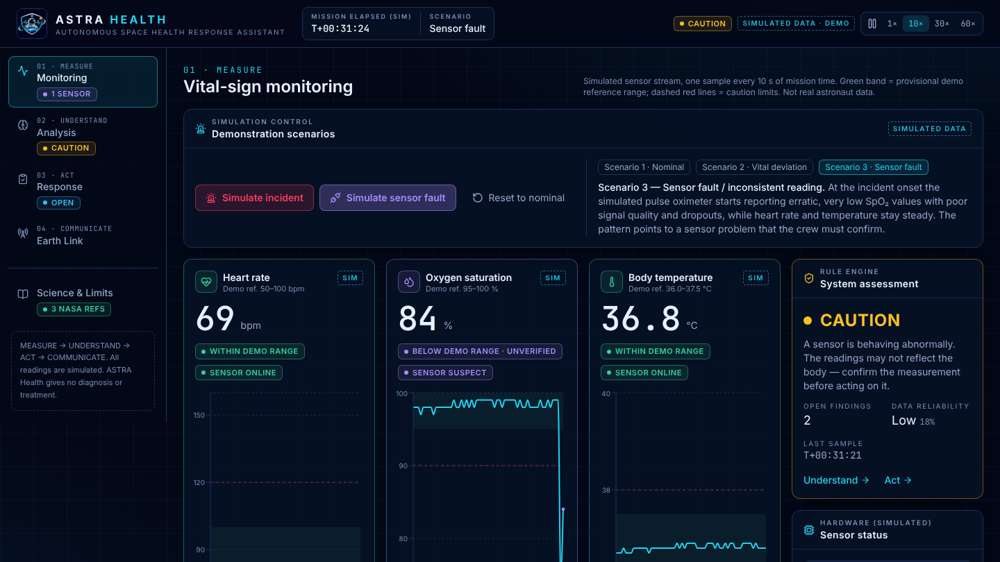

**E2E-S3-02** — Analysis reports an inconsistent reading (sensor issue), no vital deviation, reliability Low

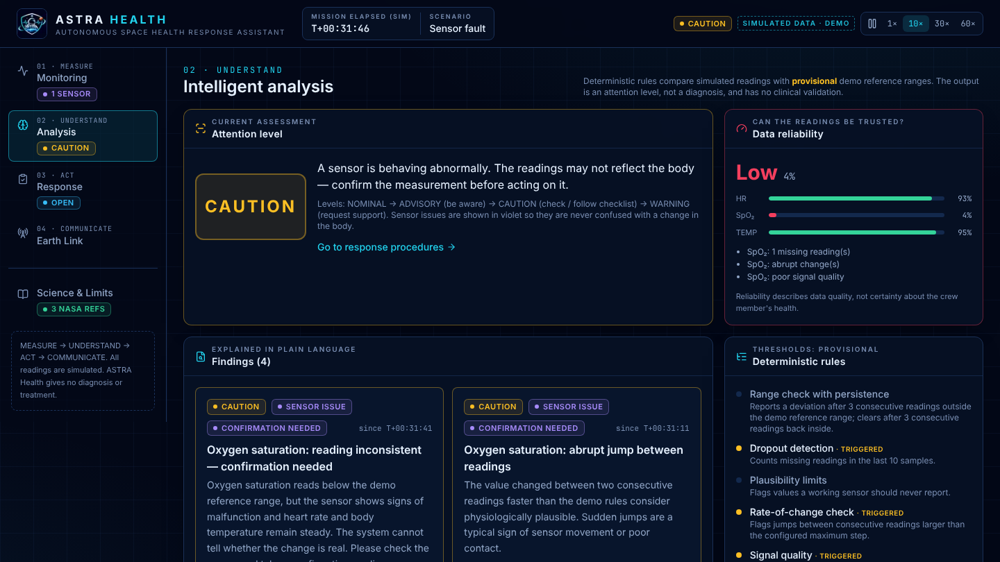

**E2E-S3-03** — Response asks to confirm the SpO₂ measurement; medical support not yet required

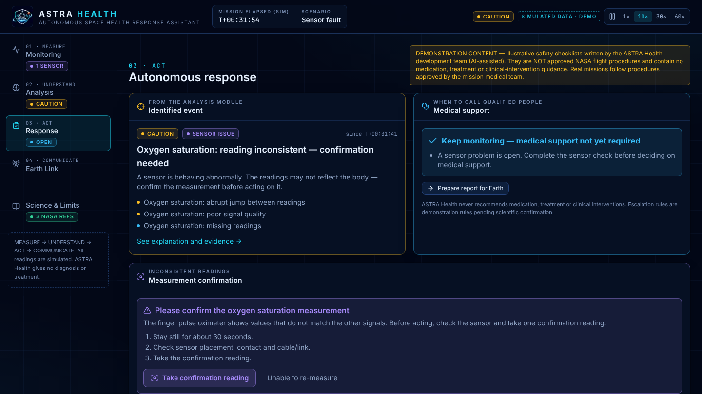

**E2E-S3-04** — Confirmation reading attributes the values to the sensor; SpO₂ excluded; ADVISORY

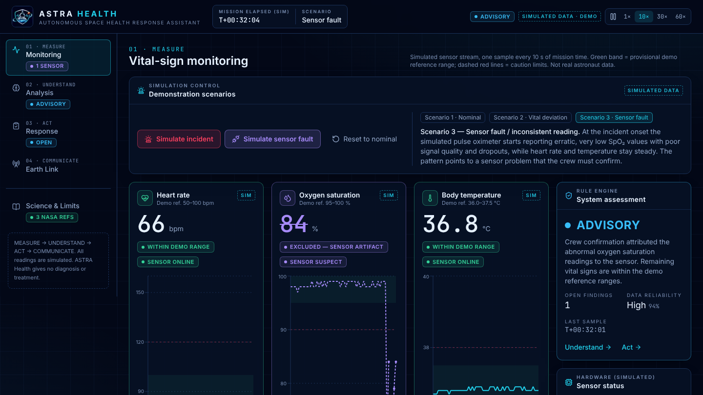

**E2E-S3-06** — Informational report contains the crew confirmation and resolved findings

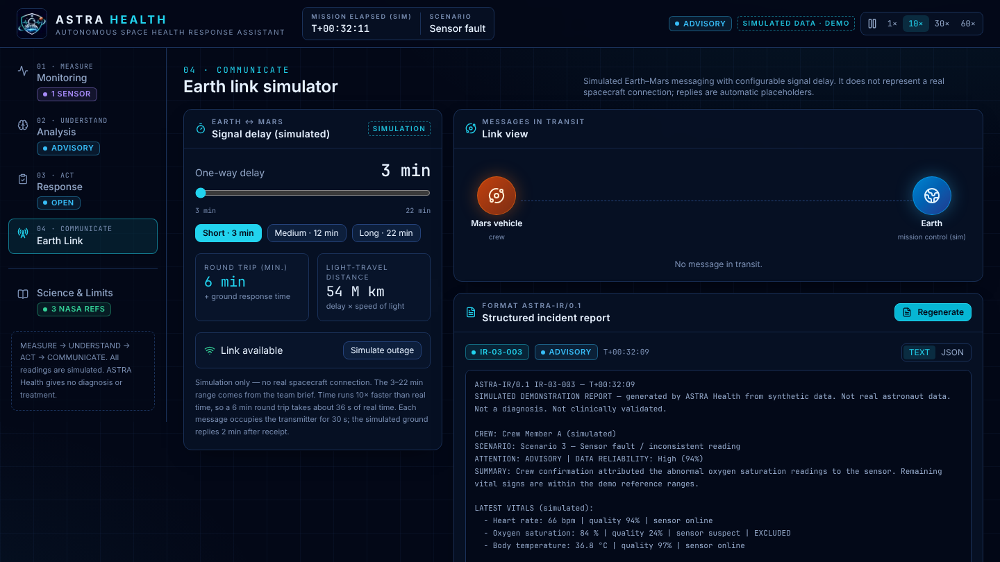

**E2E-S3-05** — If the crew cannot re-measure, medical support is recommended

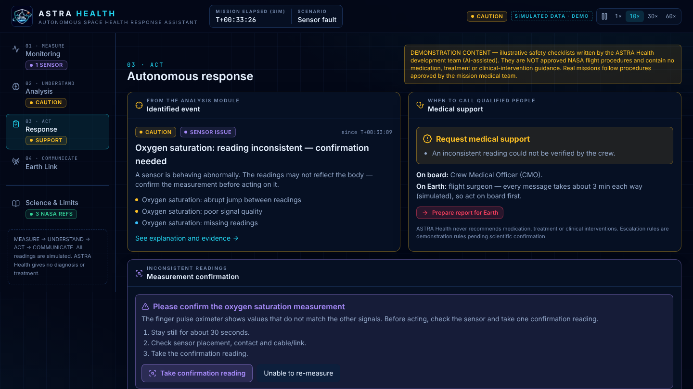

</details>

## Rastreabilidade: etapas do enunciado → casos de teste

| Etapa | Casos de aceitação | Verificações no navegador |
|---|---|---|
| MEDIR | S1-01 ✅ · S2-01 ✅ · S3-01 ✅ | E2E-S1-01 ✅ · E2E-S2-01 ✅ · E2E-S3-01 ✅ |
| ENTENDER | S1-02 ✅ · S2-02 ✅ · S2-03 ✅ · S3-02 ✅ | E2E-S1-01 ✅ · E2E-S1-02 ✅ · E2E-S2-01 ✅ · E2E-S2-02 ✅ · E2E-S3-01 ✅ · E2E-S3-02 ✅ |
| AGIR | S1-03 ✅ · S2-04 ✅ · S2-05 ✅ · S3-03 ✅ · S3-04 ✅ · S3-05 ✅ | E2E-S1-03 ✅ · E2E-S2-03 ✅ · E2E-S3-03 ✅ · E2E-S3-04 ✅ · E2E-S3-05 ✅ |
| COMUNICAR | S1-04 ✅ · S2-06 ✅ · S2-07 ✅ · S3-06 ✅ | E2E-S1-04 ✅ · E2E-S2-04 ✅ · E2E-S3-06 ✅ |

## Suíte automatizada completa

| Arquivo de teste | Aprovados | Reprovados |
|---|---|---|
| `tests/acceptance/scenarios.acceptance.test.ts` | 17 | 0 |
| `tests/analysis.test.ts` | 18 | 0 |
| `tests/comms.test.ts` | 8 | 0 |
| `tests/evidence.test.ts` | 5 | 0 |
| `tests/osdr.test.ts` | 9 | 0 |
| `tests/science.test.ts` | 5 | 0 |
| `tests/ui/modules.test.tsx` | 10 | 0 |
| `tests/ui/science.test.tsx` | 5 | 0 |
| **Total** | **77** | **0** |

## Arquivos de resultados brutos

- [`test-results/vitest-results.json`](test-results/vitest-results.json)
- [`test-results/acceptance-evidence.json`](test-results/acceptance-evidence.json)
- [`test-results/e2e-results.json`](test-results/e2e-results.json) · [`test-results/e2e/`](test-results/e2e/)
- [`../tests/acceptance/test-plan.json`](../tests/acceptance/test-plan.json) · [`../tests/acceptance/scenarios.acceptance.test.ts`](../tests/acceptance/scenarios.acceptance.test.ts) · [`../scripts/e2e-scenarios.cjs`](../scripts/e2e-scenarios.cjs)
